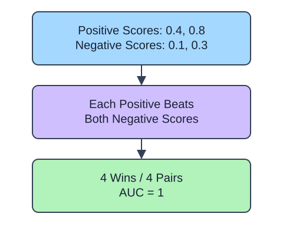

ROC AUC evaluates a ranking across thresholds. Pass continuous scores, not already thresholded predictions: converting scores to flags throws away order. Convert the actual labels to a Boolean array for the explicitly named positive class. Scores must increase toward that class.

## Dataset

`observations.csv` contains 90 original synthetic HomeHurray Inc. observations. One independent synthetic measurement observation per row. These are teaching data, not actual company performance.

| Column | Meaning and type / unit | Availability / role |
|---|---|---|
| `observation_id` | Unique string observation ID | Audit metadata, excluded from X |
| `measurement_a` | Float synthetic measurement, arbitrary signed units | Available before the synthetic outcome; feature |
| `measurement_b` | Float synthetic measurement, arbitrary signed units | Available before the synthetic outcome; feature |
| `measurement_c` | Float synthetic measurement, arbitrary signed units | Available before the synthetic outcome; feature |
| `truth` | Integer 0/1 synthetic outcome; 1 is positive | Observed label used for metric arithmetic |
| `predicted` | Fabricated integer 0/1 decision | Supplied prediction, not an input feature |
| `score` | Fabricated float in [0, 1], larger favors class 1 | Supplied score, not an input feature |

All stored values are complete. The fixed observation snapshot is 2025-01-15. The values retain their original seeded-fixture order and precision. Decisions and scores were deliberately fabricated from labels to practice metrics; they are not independent fitted-model evaluation. Figures use separate tiny illustrative counts.

The supplied setup reads the real read-only CSV tab with `pd.read_csv(..., float_precision="round_trip")` and retains pandas tables until the metric, split, or estimator operation. Data loading is supplied; edit only `main.py` for the task. The complete maintainer dictionary is stored beside the lesson in `data-dictionary.md`.

One way to read AUC is to compare every positive-negative pair. A correctly ordered positive gets one point and a tie gets half a point. Both classes must occur; this lesson deliberately excludes one-class inputs. A strictly increasing transformation preserves ranking and therefore AUC, but it need not preserve calibrated probabilities or a chosen threshold.

## A small calculation

$$
\mathrm{AUC}=\frac{W+0.5T}{N_+N_-}
$$

$W$ is the number of correctly ordered pairs, $T$ the number of tied pairs, and $N_+,N_-$ the positive and negative counts. Four wins among $2\times2$ pairs give AUC $1$.

## Your Tasks

1. In `rank_auc`, change `roc_auc_score(binary, np.asarray(scores) >= 0.5)` to `roc_auc_score(binary, scores)`.

Edit `main.py`, press Run to inspect the supplied checkpoint, then Submit. The initial demo runs but its setting does not yet meet the task. After the edit, compare the checkpoint with the original run.
