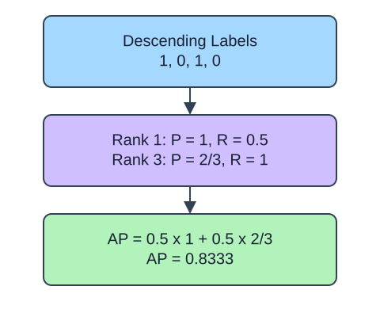

Average precision (AP) summarizes precision as recall increases down a score ranking. Unlike ROC AUC, its interpretation depends strongly on positive prevalence: a ranking that does not discriminate has a prevalence-based reference level. Compare AP only with class balance and sampling policy in view.

## Dataset

`observations.csv` contains 90 original synthetic HomeHurray Inc. observations. One independent synthetic measurement observation per row. These are teaching data, not actual company performance.

| Column | Meaning and type / unit | Availability / role |
|---|---|---|
| `observation_id` | Unique string observation ID | Audit metadata, excluded from X |
| `measurement_a` | Float synthetic measurement, arbitrary signed units | Available before the synthetic outcome; feature |
| `measurement_b` | Float synthetic measurement, arbitrary signed units | Available before the synthetic outcome; feature |
| `measurement_c` | Float synthetic measurement, arbitrary signed units | Available before the synthetic outcome; feature |
| `truth` | Integer 0/1 synthetic outcome; 1 is positive | Observed label used for metric arithmetic |
| `predicted` | Fabricated integer 0/1 decision | Supplied prediction, not an input feature |
| `score` | Fabricated float in [0, 1], larger favors class 1 | Supplied score, not an input feature |

All stored values are complete. The fixed observation snapshot is 2025-01-15. The values retain their original seeded-fixture order and precision. Decisions and scores were deliberately fabricated from labels to practice metrics; they are not independent fitted-model evaluation. Figures use separate tiny illustrative counts.

The supplied setup reads the real read-only CSV tab with `pd.read_csv(..., float_precision="round_trip")` and retains pandas tables until the metric, split, or estimator operation. Data loading is supplied; edit only `main.py` for the task. The complete maintainer dictionary is stored beside the lesson in `data-dictionary.md`.

`average_precision_score` weights precision at each recall increase. It does not compute trapezoidal area under a precision-recall plot. Keep scores continuous and identify the positive class explicitly. Tied scores enter together; do not invent a favorable within-tie order.

## A small calculation

$$
AP=\sum_j(R_j-R_{j-1})P_j
$$

$R_0=0$ before any item is retrieved.

$P_j$ is precision and $R_j$ is recall at ranking cutoff $j$. With positive ranks 1 and 3, $AP=0.5(1)+0.5(2/3)=0.8333$ (rounded).

## Your Tasks

1. In `ranking_ap`, change `average_precision_score(binary, np.asarray(scores) >= 0.5)` to `average_precision_score(binary, scores)`.

Edit `main.py`, press Run to inspect the supplied checkpoint, then Submit. The initial demo runs but its setting does not yet meet the task. After the edit, compare the checkpoint with the original run.
