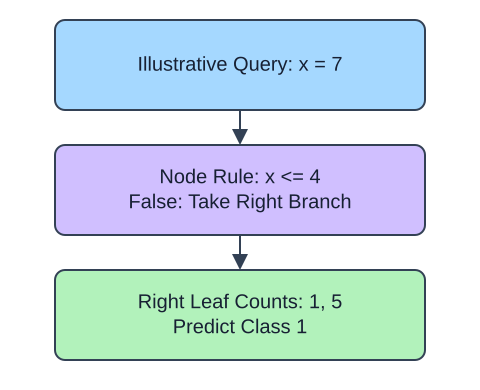

A tree makes a prediction by following a sequence of feature comparisons. Each row ends at a leaf. `max_depth` limits how many split decisions a path may contain, not how many leaves the tree may have. Allowing two decisions can separate a middle group that one split cannot isolate.

## Dataset

`observations.csv` contains 90 original synthetic HomeHurray Inc. observations. One independent synthetic measurement observation per row. These are teaching data, not actual company performance.

| Column | Meaning and type / unit | Availability / role |
|---|---|---|
| `observation_id` | Unique string observation ID | Audit metadata, excluded from X |
| `measurement_a` | Float synthetic measurement, arbitrary signed units | Available before the synthetic outcome; feature |
| `measurement_b` | Float synthetic measurement, arbitrary signed units | Available before the synthetic outcome; feature |
| `measurement_c` | Float synthetic measurement, arbitrary signed units | Available before the synthetic outcome; feature |
| `target` | Integer class 0/1 | Observed synthetic target, excluded from X |

All stored values are complete. The fixed observation snapshot is 2025-01-15. The values retain their original seeded-fixture order and precision. The identifier and target stay outside the feature table. Query perturbations in tree lessons are interface probes, not an independent held-out evaluation. Currency figures are separate arithmetic illustrations.

The supplied setup reads the real read-only CSV tab with `pd.read_csv(..., float_precision="round_trip")` and retains pandas tables until the metric, split, or estimator operation. Data loading is supplied; edit only `main.py` for the task. The complete maintainer dictionary is stored beside the lesson in `data-dictionary.md`.

`DecisionTreeClassifier` chooses splits that reduce impurity. `apply(query)` returns leaf IDs; `decision_path(query)` marks visited nodes. The supplied Run probe reports class predictions. You can inspect `tree_.feature` and `tree_.threshold` to trace a path: values less than or equal to the threshold go left. A leaf predicts its most frequent class (class-order tie breaking applies). Depth is a complexity setting, not evidence of held-out quality.

## A small calculation

$$
G=1-\sum_{k=1}^{K}p_k^2
$$

$K$ is the number of classes.

$G$ is Gini impurity and $p_k$ is the fraction of training rows of class $k$ in a node. A node split equally between two classes has $G=1-0.5^2-0.5^2=0.5$.

The supplied additional checkpoint exposes the changed policy even when the main fixture produces the same prediction. It is a probe, not another task.

## Your Tasks

1. In `fit_tree`, change `max_depth=1` to `max_depth=2`.

Edit `main.py`, press Run to inspect the supplied checkpoint, then Submit. The initial demo runs but its setting does not yet meet the task. After the edit, compare the checkpoint with the original run.
