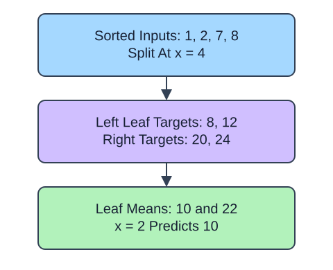

A regression tree returns a number at each leaf rather than a class. With its default squared-error criterion, that number is the mean of training targets reaching the leaf. Every query routed to the same leaf gets the same prediction. This makes the fitted function piecewise constant.

## Dataset

`observations.csv` contains 90 original synthetic HomeHurray Inc. observations. One independent synthetic measurement observation per row. These are teaching data, not actual company performance.

| Column | Meaning and type / unit | Availability / role |
|---|---|---|
| `observation_id` | Unique string observation ID | Audit metadata, excluded from X |
| `measurement_a` | Float synthetic measurement, arbitrary signed units | Available before the synthetic outcome; feature |
| `measurement_b` | Float synthetic measurement, arbitrary signed units | Available before the synthetic outcome; feature |
| `measurement_c` | Float synthetic measurement, arbitrary signed units | Available before the synthetic outcome; feature |
| `target` | Float response in arbitrary simulation units | Observed synthetic target, excluded from X |

All stored values are complete. The fixed observation snapshot is 2025-01-15. The values retain their original seeded-fixture order and precision. The identifier and target stay outside the feature table. Query perturbations in tree lessons are interface probes, not an independent held-out evaluation. Currency figures are separate arithmetic illustrations.

The supplied setup reads the real read-only CSV tab with `pd.read_csv(..., float_precision="round_trip")` and retains pandas tables until the metric, split, or estimator operation. Data loading is supplied; edit only `main.py` for the task. The complete maintainer dictionary is stored beside the lesson in `data-dictionary.md`.

Use `apply(X_train)` to identify leaf membership and compare the prediction with the mean of those targets. A query beyond the training range still follows the existing split rules; the tree does not extend a linear trend. Here the synthetic measurements illustrate fitting behavior, not a test of future price accuracy.

## A small calculation

$$
\hat y_L=\frac{1}{n_L}\sum_{i\in L}y_i
$$

$\hat y_L$ is the prediction for leaf $L$.

$L$ is a leaf, $n_L$ its training-row count, and $y_i$ a target in that leaf. Targets 8, 10, and 12 USD give $(8+10+12)/3=10$ USD.

## Your Tasks

1. In `fit_tree`, change `max_depth=1` to `max_depth=2`.

Edit `main.py`, press Run to inspect the supplied checkpoint, then Submit. The initial demo runs but its setting does not yet meet the task. After the edit, compare the checkpoint with the original run.
