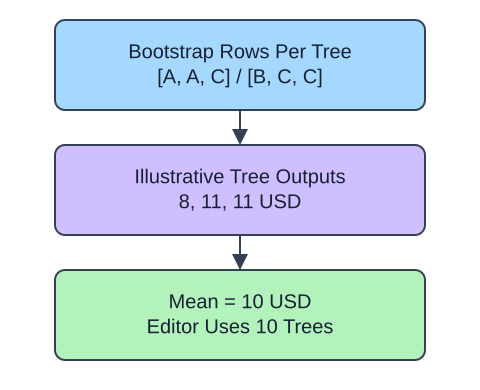

A random forest fits multiple trees using bootstrapped training samples and, depending on the setting, feature subsampling at splits. A regression forest averages tree predictions. The trees need not see identical rows or produce identical answers.

## Dataset

`observations.csv` contains 90 original synthetic HomeHurray Inc. observations. One independent synthetic measurement observation per row. These are teaching data, not actual company performance.

| Column | Meaning and type / unit | Availability / role |
|---|---|---|
| `observation_id` | Unique string observation ID | Audit metadata, excluded from X |
| `measurement_a` | Float synthetic measurement, arbitrary signed units | Available before the synthetic outcome; feature |
| `measurement_b` | Float synthetic measurement, arbitrary signed units | Available before the synthetic outcome; feature |
| `measurement_c` | Float synthetic measurement, arbitrary signed units | Available before the synthetic outcome; feature |
| `target` | Float response in arbitrary simulation units | Observed synthetic target, excluded from X |

All stored values are complete. The fixed observation snapshot is 2025-01-15. The values retain their original seeded-fixture order and precision. The identifier and target stay outside the feature table. Query perturbations in tree lessons are interface probes, not an independent held-out evaluation. Currency figures are separate arithmetic illustrations.

The supplied setup reads the real read-only CSV tab with `pd.read_csv(..., float_precision="round_trip")` and retains pandas tables until the metric, split, or estimator operation. Data loading is supplied; edit only `main.py` for the task. The complete maintainer dictionary is stored beside the lesson in `data-dictionary.md`.

Set `n_estimators=10` for this small example, bound depth, and fix the seed so comparisons repeat. `n_jobs=1` keeps computation serial. `estimators_` exposes the fitted trees; stacking their query predictions and averaging across trees should match the forest prediction. Averaging may reduce variance, but it does not guarantee a better score on every held-out sample.

## A small calculation

$$
\hat y=\frac{1}{T}\sum_{t=1}^{T}\hat y_t
$$

$\hat y$ is the forest prediction.

$T$ is tree count and $\hat y_t$ is tree $t$\'s prediction. Three illustrative tree predictions of 8, 11, and 11 USD average to 10 USD; the editor fits ten trees.

## Your Tasks

1. In `fit_forest`, change `n_estimators=1` to `n_estimators=10`.

Edit `main.py`, press Run to inspect the supplied checkpoint, then Submit. The initial demo runs but its setting does not yet meet the task. After the edit, compare the checkpoint with the original run.
