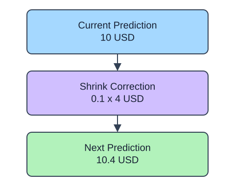

Boosting adds trees in sequence. For squared-error regression, each new tree learns a correction related to the current residuals. This differs from a forest, whose trees are averaged rather than added as sequential corrections. `learning_rate` shrinks each correction.

## Dataset

`observations.csv` contains 90 original synthetic HomeHurray Inc. observations. One independent synthetic measurement observation per row. These are teaching data, not actual company performance.

| Column | Meaning and type / unit | Availability / role |
|---|---|---|
| `observation_id` | Unique string observation ID | Audit metadata, excluded from X |
| `measurement_a` | Float synthetic measurement, arbitrary signed units | Available before the synthetic outcome; feature |
| `measurement_b` | Float synthetic measurement, arbitrary signed units | Available before the synthetic outcome; feature |
| `measurement_c` | Float synthetic measurement, arbitrary signed units | Available before the synthetic outcome; feature |
| `target` | Float response in arbitrary simulation units | Observed synthetic target, excluded from X |

All stored values are complete. The fixed observation snapshot is 2025-01-15. The values retain their original seeded-fixture order and precision. The identifier and target stay outside the feature table. Query perturbations in tree lessons are interface probes, not an independent held-out evaluation. Currency figures are separate arithmetic illustrations.

The supplied setup reads the real read-only CSV tab with `pd.read_csv(..., float_precision="round_trip")` and retains pandas tables until the metric, split, or estimator operation. Data loading is supplied; edit only `main.py` for the task. The complete maintainer dictionary is stored beside the lesson in `data-dictionary.md`.

`staged_predict(query)` yields predictions after each fitted stage. Convert it to a list only for this tiny demonstration. The last stage agrees with `predict(query)`. More stages can keep improving training fit while validation error flattens or worsens; inspect reserved validation data before choosing complexity, not the sealed test set.

## A small calculation

$$
F_{m+1}(x)=F_m(x)+\eta h_m(x)
$$

$x$ is a feature row and $m$ is the stage index.

$F_m$ is the current predictor, $h_m$ a correction tree, and $\eta$ the learning rate. At a query with $F_m=10$, $h_m=4$, $\eta=0.1$, the next prediction is 10.4.

## Your Tasks

1. In `fit_boosting`, change `n_estimators=1` to `n_estimators=15`.

Edit `main.py`, press Run to inspect the supplied checkpoint, then Submit. The initial demo runs but its setting does not yet meet the task. After the edit, compare the checkpoint with the original run.
