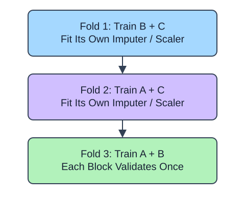
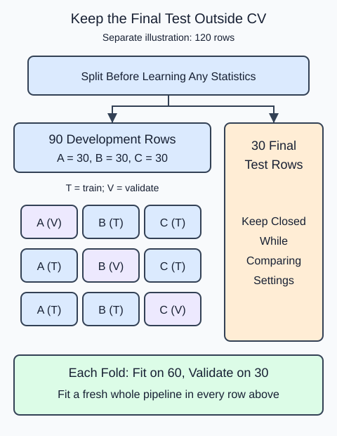

So far, a single validation partition has supported each comparison. K-fold evaluation repeats that comparison with different rows held out. `KFold` returns positional training and validation indices, not copies of the data. With three folds, every development row is validation once. Here the rows are independent synthetic measurements, so we can shuffle them with a fixed seed.

## Dataset

`observations.csv` contains 90 original synthetic HomeHurray Inc. observations. One independent synthetic measurement observation per row. These are teaching data, not actual company performance.

| Column | Meaning and type / unit | Availability / role |
|---|---|---|
| `observation_id` | Unique string observation ID | Audit metadata, excluded from X |
| `measurement_a` | Float synthetic measurement, arbitrary signed units | Available before the synthetic outcome; feature |
| `measurement_b` | Float synthetic measurement, arbitrary signed units | Available before the synthetic outcome; feature |
| `measurement_c` | Float synthetic measurement, arbitrary signed units | Available before the synthetic outcome; feature |
| `target` | Float response in arbitrary simulation units | Observed synthetic target, excluded from X |

All stored values are complete. The fixed observation snapshot is 2025-01-15. The values retain their original seeded-fixture order and precision. The identifier and target stay outside the feature table. Query perturbations in tree lessons are interface probes, not an independent held-out evaluation. Currency figures are separate arithmetic illustrations.

The supplied setup reads the real read-only CSV tab with `pd.read_csv(..., float_precision="round_trip")` and retains pandas tables until the metric, split, or estimator operation. Data loading is supplied; edit only `main.py` for the task. The complete maintainer dictionary is stored beside the lesson in `data-dictionary.md`.

Pass the entire impute-scale-Ridge pipeline to `cross_validate`; it clones and fits a fresh pipeline inside each fold. The scorer `neg_mean_absolute_error` returns negative error because search APIs maximize scores. Negate it to report positive MAE. Inspect the spread of fold errors, but do not call their standard deviation a confidence interval: training sets overlap. Final-test rows do not belong in this call. The returned key `test_score` names each fold's validation score; it does not mean that the separately reserved final test has been opened.

## A small calculation

$$
e_j=-s_j
$$

$s_j$ is the negative-MAE scorer for fold $j$ and $e_j$ is its positive MAE. Scores $-2,-3,-4$ give mean MAE $(2+3+4)/3=3$ target units.

### Where the final test stays

The next picture uses a separate 120-row illustration, not the editor's 90-row fixture. Reserve 30 rows as a final test first. Divide the remaining 90 development rows into three groups of 30. Each fold trains on two groups and validates on one; a fresh whole pipeline learns preprocessing and model parameters in that fold. The final 30 rows take no part in choosing settings.

Cross-validation changes which development rows are held out. It does not turn the final test into another fold.

## Your Tasks

1. In `evaluate_folds`, change `result['test_score']` to `-result['test_score']`.

Edit `main.py`, press Run to inspect the supplied checkpoint, then Submit. The initial demo runs but its setting does not yet meet the task. After the edit, compare the checkpoint with the original run.
