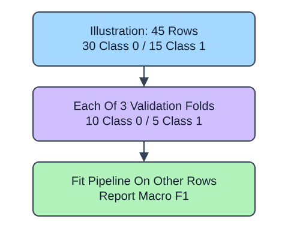

StratifiedKFold aims to preserve class proportions across validation folds. Supply `y` to `split` so the splitter can distribute classes; each class needs enough examples for the requested folds. Stratification does not prevent repeated-customer leakage or enforce time order.

The whole scaler-logistic pipeline fits separately in each fold. Use `scoring="f1_macro"` to average the class F1 values equally instead of default accuracy. The result contains one score per validation fold. Report those scores without interpreting their variability as an independent-sample confidence interval.

The demo evaluates the bundled iris benchmark; the exercise transfers to wine. These external benchmark observations are not HomeHurray data. `dataset.target_names` names the three integer classes, and `feature_names` describes the measured columns. The local `DESCR` gives provenance and dataset terms, which are not automatically the scikit-learn software license. The figure shows a separate imbalanced-class illustration, not iris class counts.

## Data used here

These are bundled external benchmark observations, not company records. The fabricated predictions in the F1 lesson are only arithmetic fixtures. No external dataset is fetched.

| Field | Type / units / domain | Missing | Available | Role |
|---|---|---|---|---|
| `X_train` | iris: 4 float sepal/petal lengths and widths in cm; wine: 13 float chemical measurements with dataset-defined units | none | benchmark observation | predictors |
| `y_train` | integer class 0/1/2, names in `dataset.target_names` | none | labeled observation | target |
| `feature_names` | supplied column names | none | dataset metadata | interpretation only |

Iris has 150 rows and wine has 178. Read the dataset `DESCR` for individual wine measurement definitions; these are educational benchmark classifications, not clinical or causal claims.

## Your Tasks

1. In `evaluate_classes`, change `scoring='accuracy'` to `scoring='f1_macro'`.

Edit `main.py`, press Run to inspect the supplied checkpoint, then Submit. The initial demo runs but its setting does not yet meet the task. After the edit, compare the checkpoint with the original run.
