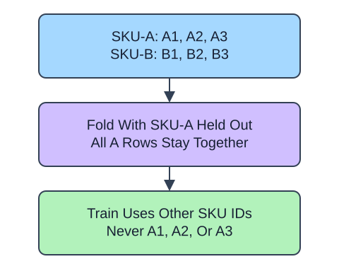

Repeated measurements of one product share information. A random row split can put nearly identical observations on both sides of a fold, answering the wrong question if the goal is a new product. `GroupKFold` keeps every row of each supplied group together.

## Dataset

`observations.csv` contains 24 original synthetic HomeHurray Inc. observations. One repeated product measurement per row; all observations of an ID belong to the same entity. These are teaching data, not actual company performance.

| Column | Meaning and type / unit | Availability / role |
|---|---|---|
| `product_id` | String product/entity ID; repeated across rows | Known before splitting; group metadata, never a feature |
| `measurement_a` | Integer synthetic measurement, arbitrary units | Known at observation; feature |
| `measurement_b` | Integer synthetic measurement, arbitrary units | Known at observation; feature |

All values are complete. The fixed synthetic snapshot is 2025-01-15; there is no target in this split-membership exercise. Six product IDs occur in the file. Group separation, rather than random row separation, defines the validation boundary.

The supplied setup reads the real read-only CSV tab with `pd.read_csv(..., float_precision="round_trip")` and retains pandas tables until the metric, split, or estimator operation. Data loading is supplied; edit only `main.py` for the task. The complete maintainer dictionary is stored beside the lesson in `data-dictionary.md`.

Pass product IDs through `groups`, not as numeric predictors. Three folds need at least three distinct groups. Validation row counts may differ because whole groups cannot always be balanced exactly. This lesson inspects membership before fitting anything. Later, pass these folds to whole-pipeline evaluation; never fit preprocessing before creating the folds.

The supplied additional checkpoint exposes the changed policy even when the main fixture produces the same prediction. It is a probe, not another task.

## Your Tasks

1. In `entity_folds`, change `KFold(n_splits=3, shuffle=True, random_state=17)` to `GroupKFold(n_splits=3)`.

Edit `main.py`, press Run to inspect the supplied checkpoint, then Submit. The initial demo runs but its setting does not yet meet the task. After the edit, compare the checkpoint with the original run.
