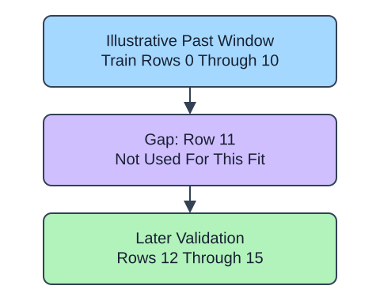

TimeSeriesSplit grows a training prefix and evaluates later rows. Sort by timestamp first and never shuffle those rows. Here observations represent consecutive daily slots for synthetic order summaries, so a gap of one row also means one day. That equivalence disappears for irregular timestamps.

## Dataset

`observations.csv` contains 36 original synthetic HomeHurray Inc. observations. One consecutive daily slot per row, starting 2025-01-01. These are teaching data, not actual company performance.

| Column | Meaning and type / unit | Availability / role |
|---|---|---|
| `date` | ISO date string, equally spaced daily | Ordering metadata; sort order must be preserved |
| `daily_index` | Integer daily row index; not an order-volume measurement | Known on that date; aligned feature |

Both columns are complete. The demonstration ends 2025-02-05; the exercise ends 2025-03-01. No delayed outcome target is fitted here. The one-row gap illustrates index separation; it does not prove that a 30-day label window has matured.

The supplied setup reads the real read-only CSV tab with `pd.read_csv(..., float_precision="round_trip")` and retains pandas tables until the metric, split, or estimator operation. Data loading is supplied; edit only `main.py` for the task. The complete maintainer dictionary is stored beside the lesson in `data-dictionary.md`.

`test_size=4` reserves four rows per validation block. `gap=1` leaves one row between the training end and validation start. A gap alone does not guarantee label availability: if a label needs a thirty-day outcome window, training labels must have matured by the prediction cutoff. This tiny one-day illustration is not the return-risk project protocol.

## A small calculation

$$
g=v_0-t_{\max}-1
$$

$g$ counts excluded rows, $v_0$ is the first validation index, and $t_{\max}$ the last training index. Indices 10 and 12 leave $12-10-1=1$ row; elapsed time depends on timestamps.

## Your Tasks

1. In `future_folds`, change `gap=0` to `gap=1`.

Edit `main.py`, press Run to inspect the supplied checkpoint, then Submit. The initial demo runs but its setting does not yet meet the task. After the edit, compare the checkpoint with the original run.
