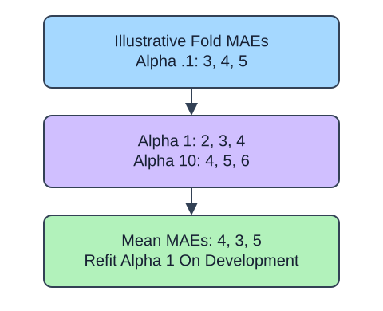

GridSearchCV compares each listed setting on the same development folds. `ridge__alpha` means the `alpha` parameter of the pipeline step named `ridge`; the double underscore reaches inside the pipeline. Each candidate fold refits imputation and scaling using only that fold's training rows.

## Dataset

`observations.csv` contains 90 original synthetic HomeHurray Inc. observations. One independent synthetic measurement observation per row. These are teaching data, not actual company performance.

| Column | Meaning and type / unit | Availability / role |
|---|---|---|
| `observation_id` | Unique string observation ID | Audit metadata, excluded from X |
| `measurement_a` | Float synthetic measurement, arbitrary signed units | Available before the synthetic outcome; feature |
| `measurement_b` | Float synthetic measurement, arbitrary signed units | Available before the synthetic outcome; feature |
| `measurement_c` | Float synthetic measurement, arbitrary signed units | Available before the synthetic outcome; feature |
| `target` | Float response in arbitrary simulation units | Observed synthetic target, excluded from X |

All stored values are complete. The fixed observation snapshot is 2025-01-15. The values retain their original seeded-fixture order and precision. The identifier and target stay outside the feature table. Query perturbations in tree lessons are interface probes, not an independent held-out evaluation. Currency figures are separate arithmetic illustrations.

The supplied setup reads the real read-only CSV tab with `pd.read_csv(..., float_precision="round_trip")` and retains pandas tables until the metric, split, or estimator operation. Data loading is supplied; edit only `main.py` for the task. The complete maintainer dictionary is stored beside the lesson in `data-dictionary.md`.

With `refit=True`, the winner is then fitted on all rows passed to `fit`, not on any separately reserved final test. `best_score_` is a selection score and is optimistic as an evaluation of the selection process. RandomizedSearchCV is a bounded alternative: `n_iter` samples a fixed number of settings from distributions or lists rather than enumerating a grid. It still needs the same whole-pipeline and holdout boundaries.

## A small calculation

$$
N_{\mathrm{fits}}=C K+1
$$

$N_{\mathrm{fits}}$ counts model fits.

$C$ is candidate count and $K$ is fold count. Three candidates and three folds require $3\times3+1=10$ fits including the final refit.

The supplied additional checkpoint exposes the changed policy even when the main fixture produces the same prediction. It is a probe, not another task.

## Your Tasks

1. In `search_model`, change `scoring='r2'` to `scoring='neg_mean_absolute_error'`.

Edit `main.py`, press Run to inspect the supplied checkpoint, then Submit. The initial demo runs but its setting does not yet meet the task. After the edit, compare the checkpoint with the original run.
