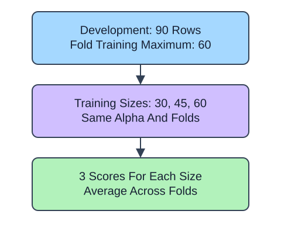

A learning curve changes the amount of training data while keeping model settings fixed. The x-axis is training-row count, not alpha or tree depth. `learning_curve` returns actual sizes and two matrices: one row per size and one column per fold.

## Dataset

`observations.csv` contains 90 original synthetic HomeHurray Inc. observations. One independent synthetic measurement observation per row. These are teaching data, not actual company performance.

| Column | Meaning and type / unit | Availability / role |
|---|---|---|
| `observation_id` | Unique string observation ID | Audit metadata, excluded from X |
| `measurement_a` | Float synthetic measurement, arbitrary signed units | Available before the synthetic outcome; feature |
| `measurement_b` | Float synthetic measurement, arbitrary signed units | Available before the synthetic outcome; feature |
| `measurement_c` | Float synthetic measurement, arbitrary signed units | Available before the synthetic outcome; feature |
| `target` | Float response in arbitrary simulation units | Observed synthetic target, excluded from X |

All stored values are complete. The fixed observation snapshot is 2025-01-15. The values retain their original seeded-fixture order and precision. The identifier and target stay outside the feature table. Query perturbations in tree lessons are interface probes, not an independent held-out evaluation. Currency figures are separate arithmetic illustrations.

The supplied setup reads the real read-only CSV tab with `pd.read_csv(..., float_precision="round_trip")` and retains pandas tables until the metric, split, or estimator operation. Data loading is supplied; edit only `main.py` for the task. The complete maintainer dictionary is stored beside the lesson in `data-dictionary.md`.

Fractions such as 0.5 are relative to the maximum training portion within a fold, not the full dataset. Keep the whole pipeline inside the call so every subset learns its own preprocessing. Negate negative-MAE scores before averaging across columns. Comparing training and validation errors can suggest whether more data might help, but neither curve must improve monotonically on a small sample.

## A small calculation

$$
\bar e_m=\frac{1}{K}\sum_{j=1}^{K}e_{m,j}
$$

$\bar e_m$ is the mean validation error at training size $m$.

$e_{m,j}$ is MAE at training size $m$ in fold $j$; $K$ is fold count. A row of errors 2, 3, and 4 has mean 3 target units.

## Your Tasks

1. In `size_curve`, change `train_scores, validation_scores` to `-train_scores, -validation_scores`.

Edit `main.py`, press Run to inspect the supplied checkpoint, then Submit. The initial demo runs but its setting does not yet meet the task. After the edit, compare the checkpoint with the original run.
