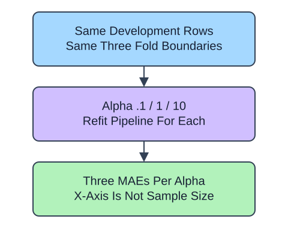

A validation curve changes one model setting while keeping the development rows and folds fixed. Here the x-axis is Ridge alpha, unlike the training-size axis of a learning curve. `param_name="ridge__alpha"` selects the nested pipeline setting and `param_range` fixes its tested order.

## Dataset

`observations.csv` contains 90 original synthetic HomeHurray Inc. observations. One independent synthetic measurement observation per row. These are teaching data, not actual company performance.

| Column | Meaning and type / unit | Availability / role |
|---|---|---|
| `observation_id` | Unique string observation ID | Audit metadata, excluded from X |
| `measurement_a` | Float synthetic measurement, arbitrary signed units | Available before the synthetic outcome; feature |
| `measurement_b` | Float synthetic measurement, arbitrary signed units | Available before the synthetic outcome; feature |
| `measurement_c` | Float synthetic measurement, arbitrary signed units | Available before the synthetic outcome; feature |
| `target` | Float response in arbitrary simulation units | Observed synthetic target, excluded from X |

All stored values are complete. The fixed observation snapshot is 2025-01-15. The values retain their original seeded-fixture order and precision. The identifier and target stay outside the feature table. Query perturbations in tree lessons are interface probes, not an independent held-out evaluation. Currency figures are separate arithmetic illustrations.

The supplied setup reads the real read-only CSV tab with `pd.read_csv(..., float_precision="round_trip")` and retains pandas tables until the metric, split, or estimator operation. Data loading is supplied; edit only `main.py` for the task. The complete maintainer dictionary is stored beside the lesson in `data-dictionary.md`.

Each returned score matrix has one row per alpha and one column per fold. Convert negative MAE to positive errors and average across columns to compare settings. The same validation scores used to choose alpha cannot then serve as an unbiased final evaluation; reserve the final test or evaluate the selection process with outer folds.

## A small calculation

$$
\bar e_a=\frac{e_{a,1}+e_{a,2}+e_{a,3}}{3}
$$

$\bar e_a$ is the mean validation error at alpha $a$.

$e_{a,j}$ is validation MAE for alpha $a$ in fold $j$. Errors 1, 2, and 3 at one alpha average to 2 target units; this is not a test-set score.

## Your Tasks

1. In `alpha_curve`, change `train_scores, validation_scores` to `-train_scores, -validation_scores`.

Edit `main.py`, press Run to inspect the supplied checkpoint, then Submit. The initial demo runs but its setting does not yet meet the task. After the edit, compare the checkpoint with the original run.
