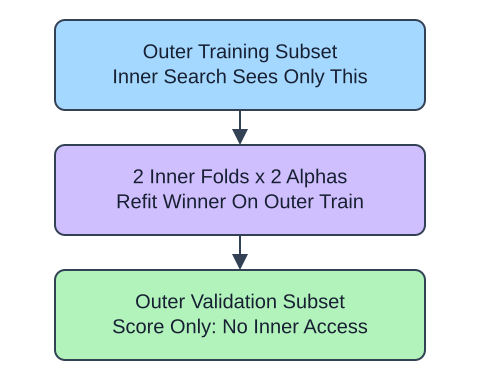

Nested cross-validation evaluates a model-selection procedure. The inner search chooses alpha using only an outer training fold. Its best pipeline refits on that outer training fold, then predicts the untouched outer validation fold. Each outer fold runs a separate search.

## Dataset

`observations.csv` contains 90 original synthetic HomeHurray Inc. observations. One independent synthetic measurement observation per row. These are teaching data, not actual company performance.

| Column | Meaning and type / unit | Availability / role |
|---|---|---|
| `observation_id` | Unique string observation ID | Audit metadata, excluded from X |
| `measurement_a` | Float synthetic measurement, arbitrary signed units | Available before the synthetic outcome; feature |
| `measurement_b` | Float synthetic measurement, arbitrary signed units | Available before the synthetic outcome; feature |
| `measurement_c` | Float synthetic measurement, arbitrary signed units | Available before the synthetic outcome; feature |
| `target` | Float response in arbitrary simulation units | Observed synthetic target, excluded from X |

All stored values are complete. The fixed observation snapshot is 2025-01-15. The values retain their original seeded-fixture order and precision. The identifier and target stay outside the feature table. Query perturbations in tree lessons are interface probes, not an independent held-out evaluation. Currency figures are separate arithmetic illustrations.

The supplied setup reads the real read-only CSV tab with `pd.read_csv(..., float_precision="round_trip")` and retains pandas tables until the metric, split, or estimator operation. Data loading is supplied; edit only `main.py` for the task. The complete maintainer dictionary is stored beside the lesson in `data-dictionary.md`.

Two outer folds, two inner folds, and two candidates keep this example small. The inner split indices refer to the outer training subset, not the full table. Preprocessing stays inside the searched pipeline at both levels. Report the mean outer MAE as a limited estimate for this procedure; overlapping training data and only two folds do not justify a confidence interval. A separately sealed final test remains unused.

## A small calculation

$$
\bar e=\frac{e_1+e_2}{2}
$$

$\bar e$ is the mean outer-fold error.

$e_1,e_2$ are outer-fold MAEs. Illustrative errors 2 and 4 average to 3. Two outer folds each use $2\times2+1=5$ fits, for 10 fits total.

## Your Tasks

1. In `nested_scores`, change `result['test_score']` to `-result['test_score']`.

Edit `main.py`, press Run to inspect the supplied checkpoint, then Submit. The initial demo runs but its setting does not yet meet the task. After the edit, compare the checkpoint with the original run.
