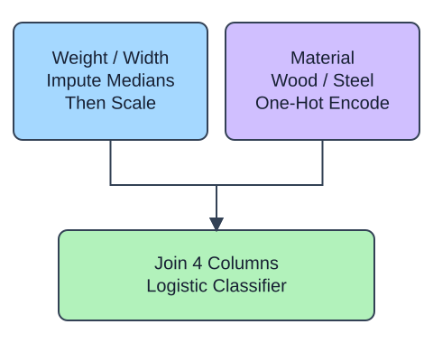

Before building the checkout return-risk model, try the mixed pipeline on a small furniture-handling example. Weight, width, and material are known before handling; the synthetic flag arrives afterward. The supplied pipeline learns numeric medians and scales from training, then encodes the material labels. Your change makes it accept an unfamiliar material without learning a new category.

## Dataset

`handling.csv` contains 30 original synthetic HomeHurray Inc. observations. One synthetic furniture-handling observation per row. These are teaching data, not actual company performance.

| Column | Meaning and type / unit | Availability / role |
|---|---|---|
| `weight_kg` | Float package weight, kg | Known before handling; numeric predictor |
| `width_cm` | Float width, cm | Known before handling; numeric predictor |
| `material` | Nominal wood / steel | Known before handling; categorical predictor |
| `flagged` | Integer 0/1 handling flag | Observed later; target |

A blank weight means an unrecorded measurement; other fields are complete. `glass` is an unseen query material, not a stored training category. The fixed observation snapshot is 2025-01-15. The supplied positional slices contain 18 training, 6 validation, and 6 final-test observations. This is a small standalone analogue, not the checkout project table.

The supplied setup reads the real read-only CSV tab with `pd.read_csv(..., float_precision="round_trip")` and retains pandas tables until the metric, split, or estimator operation. Data loading is supplied; edit only `main.py` for the task. The complete maintainer dictionary is stored beside the lesson in `data-dictionary.md`.

An unseen material is not a missing numeric value. `handle_unknown="ignore"` gives it zero indicators for the training categories rather than raising an error. This avoids a crash but does not establish reliable predictions for an unseen material. Run prints the encoder policy without querying an unseen material; Submit probes glass. After the edit, the printed policy changes from error to ignore.

## Your Tasks

1. Change `handle_unknown='error'` to `handle_unknown='ignore'` in `build_model` so the analogue follows the described policy.

Edit `main.py`, press Run to inspect the supplied checkpoint, then Submit. The initial demo runs but its setting does not yet meet the task. After the edit, compare the checkpoint with the original run.
