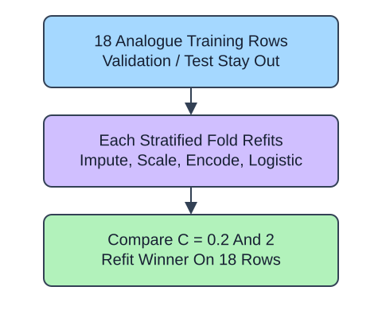

This standalone furniture analogue compares C values 0.2 and 2.0 using only its 18 training rows. Three stratified folds retain both classes. The six-row validation and test slices are excluded from the search.

## Dataset

`handling.csv` contains 30 original synthetic HomeHurray Inc. observations. One synthetic furniture-handling observation per row. These are teaching data, not actual company performance.

| Column | Meaning and type / unit | Availability / role |
|---|---|---|
| `weight_kg` | Float package weight, kg | Known before handling; numeric predictor |
| `width_cm` | Float width, cm | Known before handling; numeric predictor |
| `material` | Nominal wood / steel | Known before handling; categorical predictor |
| `flagged` | Integer 0/1 handling flag | Observed later; target |

A blank weight means an unrecorded measurement; other fields are complete. `glass` is an unseen query material, not a stored training category. The fixed observation snapshot is 2025-01-15. The supplied positional slices contain 18 training, 6 validation, and 6 final-test observations. This is a small standalone analogue, not the checkout project table.

The supplied setup reads the real read-only CSV tab with `pd.read_csv(..., float_precision="round_trip")` and retains pandas tables until the metric, split, or estimator operation. Data loading is supplied; edit only `main.py` for the task. The complete maintainer dictionary is stored beside the lesson in `data-dictionary.md`.

Change the selection objective from accuracy to macro F1. Because class 1 is less common, accuracy and an equal-class average answer different questions. `refit=True` then trains the winning whole pipeline on the same training slice.

The supplied additional checkpoint exposes the changed policy even when the main fixture produces the same prediction. It is a probe, not another task.

## Your Tasks

1. Change `scoring='accuracy'` to `scoring='f1_macro'` in `tune_model` so the analogue follows the described policy.

Edit `main.py`, press Run to inspect the supplied checkpoint, then Submit. The initial demo runs but its setting does not yet meet the task. After the edit, compare the checkpoint with the original run.
