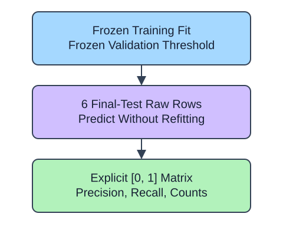

The furniture analogue has already selected its model and threshold without its final six-row slice. The report now opens that slice once for evaluation. It counts observed/predicted classes with explicit `[0, 1]` order.

## Dataset

`handling.csv` contains 30 original synthetic HomeHurray Inc. observations. One synthetic furniture-handling observation per row. These are teaching data, not actual company performance.

| Column | Meaning and type / unit | Availability / role |
|---|---|---|
| `weight_kg` | Float package weight, kg | Known before handling; numeric predictor |
| `width_cm` | Float width, cm | Known before handling; numeric predictor |
| `material` | Nominal wood / steel | Known before handling; categorical predictor |
| `flagged` | Integer 0/1 handling flag | Observed later; target |

A blank weight means an unrecorded measurement; other fields are complete. `glass` is an unseen query material, not a stored training category. The fixed observation snapshot is 2025-01-15. The supplied positional slices contain 18 training, 6 validation, and 6 final-test observations. This is a small standalone analogue, not the checkout project table.

The supplied setup reads the real read-only CSV tab with `pd.read_csv(..., float_precision="round_trip")` and retains pandas tables until the metric, split, or estimator operation. Data loading is supplied; edit only `main.py` for the task. The complete maintainer dictionary is stored beside the lesson in `data-dictionary.md`.

Reversing the label order still produces a two-by-two matrix with the same total, but moves the meaning of every cell. Make the order match the report contract rather than inferring it from the shape. The helper predicts only; it does not refit or retune.

## Your Tasks

1. Change `labels=[1, 0]` to `labels=[0, 1]` in `final_report` so the analogue follows the described policy.

Edit `main.py`, press Run to inspect the supplied checkpoint, then Submit. The initial demo runs but its setting does not yet meet the task. After the edit, compare the checkpoint with the original run.
