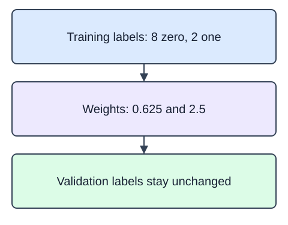

The return-risk project kept model selection and final evaluation separate. Keep that boundary for this new comparison: what changes when errors on a rare class receive more weight? `class_weight="balanced"` gives each training class the same total weight. It does not create orders or change validation labels, and better recall is not guaranteed.

`compute_class_weight` returns one weight for each entry in `classes`, in that order. The supplied `LogisticRegression` fits the training inputs only; `predict` returns class labels for the untouched validation rows. Compare the two confusion matrices rather than treating a change in accuracy as an automatic improvement. Rows of each matrix are actual classes and columns are predicted classes. Both matrices describe exactly the same validation orders.

The fixture has two synthetic checkout measurements and binary return labels. The feature columns are dimensionless teaching measurements, not validated business predictors. The train/validation split is supplied and stratified so both classes remain represented.

For class $c$, the balanced weight is

$$
w_c=\frac{n}{C n_c}.
$$

Here $n$ is the number of training rows, $C$ the number of classes, and $n_c$ the training count of class $c$. Weights have no unit. With eight zeros and two ones, $n=10$ and $C=2$:

$$
w_0=\frac{10}{2(8)}=0.625,\qquad w_1=\frac{10}{2(2)}=2.5.
$$

Each class has total weight five. `compute_class_weight` produces these same values.

The diagram uses the ten-label arithmetic example, separate from the generated training split.

The starter runs a comparison baseline. Change the classifier's `class_weight` from `None` to `"balanced"`.

## Dataset

The supplied `pd.read_csv` setup reads that real file and selects named feature columns; the ID column stays outside the model. The numeric indices are dimensionless synthetic measurements, not currency or measured business outcomes. `returned` is a synthetic binary teaching label; only the training partition may fit model state.

`checkout-measurements.csv` has **36 rows**, each representing one synthetic checkout.

| Column | Meaning | Type / unit | Role or availability |
|---|---|---|---|
| `order_id` | Synthetic checkout record ID; excluded from predictors | string; none | ID; excluded from predictors |
| `basket_index` | Synthetic basket measurement on a dimensionless scale | float; dimensionless | Supplied predictor input |
| `item_count_index` | Synthetic checkout size index; not a literal item count | float; dimensionless | Supplied predictor input |
| `returned` | Artificial binary outcome, 0 or 1; not a feature | integer; none | Outcome label; not a predictor |

These records are original synthetic HomeHurray teaching data. Feature/ID fields are complete. Missing fields are not allowed in this fixed fixture.

The data tabs are read-only in the editor. Edit `main.py`; the file-reading setup is supplied, not an additional task.

## Your Tasks

1. Return a fitted `LogisticRegression` with `class_weight="balanced"`, `max_iter=300`, and `n_jobs=1` from `fit_weighted(X, y)`.

Edit `main.py`, press Run to inspect the supplied checkpoint, then Submit to check the helper. The probe is supplied; you do not need to add printing.
