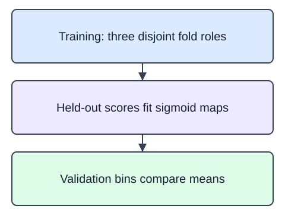

A classifier's ordering can be useful while its probabilities are too extreme. Calibration learns a mapping from scores to observed outcomes. `CalibratedClassifierCV` with `method="sigmoid"` fits a smooth probability mapping; it is not a promise of perfectly calibrated predictions.

The supplied `StratifiedKFold` makes three shuffled, reproducible folds. With `ensemble=True`, each base estimator trains on two folds and its calibrator learns from predictions on the third. The final probability is an average across those fitted pairs. Validation rows never enter either fit. Each class needs enough training examples for all folds.

`calibration_curve` groups validation probabilities into bins. Its two outputs are the positive fraction and mean predicted probability for each nonempty bin. Empty bins disappear, so three requested bins do not guarantee three points. A bin with two rows is weak evidence; inspect its count as well as its location. The supplied histogram reports counts for the same uniform intervals.

Within a nonempty bin $B$, compare

$$
\bar p_B=\frac{1}{m}\sum_{i\in B}p_i,\qquad f_B=\frac{1}{m}\sum_{i\in B}y_i.
$$

Here $m$ is the bin's row count, $p_i$ its predicted probability, and $y_i$ its binary outcome. Both values are unitless fractions. For probabilities $0.6,0.8$ and labels $1,0$, the mean probability is $0.7$ but the positive fraction is $0.5$. This small discrepancy illustrates the calculation, not a reliable estimate of calibration quality.

The starter runs a comparison baseline. Change the calibration method from `"isotonic"` to `"sigmoid"`.

## Dataset

The supplied `pd.read_csv` setup reads that real file and selects named feature columns; the ID column stays outside the model. The numeric indices are dimensionless synthetic measurements, not currency or measured business outcomes. `returned` is a synthetic binary teaching label; only the training partition may fit model state.

`checkout-measurements.csv` has **36 rows**, each representing one synthetic checkout.

| Column | Meaning | Type / unit | Role or availability |
|---|---|---|---|
| `order_id` | Synthetic checkout record ID; excluded from predictors | string; none | ID; excluded from predictors |
| `basket_index` | Synthetic basket measurement on a dimensionless scale | float; dimensionless | Supplied predictor input |
| `item_count_index` | Synthetic checkout size index; not a literal item count | float; dimensionless | Supplied predictor input |
| `category_index` | Synthetic numeric product-mix index; not an encoded category ID | float; dimensionless | Supplied predictor input |
| `returned` | Artificial binary outcome, 0 or 1; not a feature | integer; none | Outcome label; not a predictor |

These records are original synthetic HomeHurray teaching data. Feature/ID fields are complete. Missing fields are not allowed in this fixed fixture.

The data tabs are read-only in the editor. Edit `main.py`; the file-reading setup is supplied, not an additional task.

## Your Tasks

1. Fit and return `CalibratedClassifierCV` using sigmoid calibration, the supplied three-fold splitter, `ensemble=True`, and `n_jobs=1` in `fit_calibrated(X, y)`.

Edit `main.py`, press Run to inspect the supplied checkpoint, then Submit to check the helper. The probe is supplied; you do not need to add printing.
