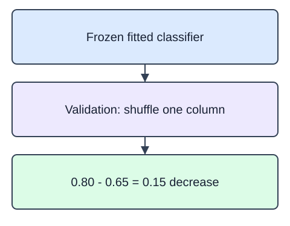

Permutation importance asks how much a fitted model's score changes when one validation column is shuffled. Keep the fitted estimator unchanged. Shuffling breaks that column's association with outcomes while preserving its individual values.

`permutation_importance` returns a score decrease for each feature and repeat. Here `scoring="accuracy"` makes the units accuracy points, `n_repeats=3` limits the small experiment, and `random_state=17` makes shuffles reproducible. `importances` has shape `(n_features, 3)`; the mean and standard deviation summarize repeats, not uncertainty over all possible future datasets.

Use development validation rows for inspection. Looking at test importance and then revising features would consume the final test. Correlated columns can substitute for one another and appear individually unimportant. A negative decrease means that particular shuffle improved the score; do not clamp it to zero. None of these quantities establishes a causal effect.

For feature $j$ and repeat $r$,

$$
I_{jr}=s_0-s_{jr}.
$$

Here $s_0$ is the original validation score, $s_{jr}$ is the score after shuffling column $j$ in repeat $r$, and $I_{jr}$ is its importance for that repeat. A baseline accuracy of $0.80$ and shuffled accuracy of $0.65$ give $I_{jr}=0.15$. The library averages these decreases across repeats for `importances_mean`.

The diagram illustrates a possible score decrease, not the editor fixture's measured result.

The starter runs a comparison baseline. Change `n_repeats` from 1 to 3.

## Dataset

The supplied `pd.read_csv` setup reads that real file and selects named feature columns; the ID column stays outside the model. The numeric indices are dimensionless synthetic measurements, not currency or measured business outcomes. `returned` is a synthetic binary teaching label; only the training partition may fit model state.

`checkout-measurements.csv` has **36 rows**, each representing one synthetic checkout.

| Column | Meaning | Type / unit | Role or availability |
|---|---|---|---|
| `order_id` | Synthetic checkout record ID; excluded from predictors | string; none | ID; excluded from predictors |
| `basket_index` | Synthetic basket measurement on a dimensionless scale | float; dimensionless | Supplied predictor input |
| `item_count_index` | Synthetic checkout size index; not a literal item count | float; dimensionless | Supplied predictor input |
| `category_index` | Synthetic numeric product-mix index; not an encoded category ID | float; dimensionless | Supplied predictor input |
| `returned` | Artificial binary outcome, 0 or 1; not a feature | integer; none | Outcome label; not a predictor |

These records are original synthetic HomeHurray teaching data. Feature/ID fields are complete. Missing fields are not allowed in this fixed fixture.

The data tabs are read-only in the editor. Edit `main.py`; the file-reading setup is supplied, not an additional task.

## Your Tasks

1. Return `permutation_importance` for the supplied fitted model and validation arrays from `inspect_features`, using accuracy, three repeats, seed 17, and `n_jobs=1`.

Edit `main.py`, press Run to inspect the supplied checkpoint, then Submit to check the helper. The probe is supplied; you do not need to add printing.
