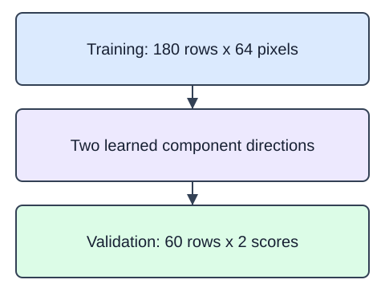
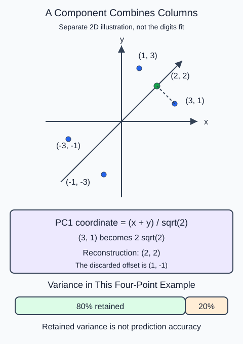

PCA replaces correlated columns with orthogonal linear combinations called components. It centers the training matrix and finds directions of high variance. A component is not a selected input column, and high variance does not guarantee usefulness for a target.

`PCA(n_components=2, svd_solver="full")` learns two directions. `transform` gives two coordinates per new row. `inverse_transform` maps those coordinates back into the original feature space; discarded directions mean the reconstruction is approximate. The demo uses the first 240 rows of the bundled digits benchmark, not HomeHurray data. Its 64 columns are 8-by-8 image intensities from 0 to 16. The exercise uses original correlated numeric measurements instead.

Fit on training rows before transforming validation. `explained_variance_ratio_` gives one fraction per retained component relative to total training variance. Summing those fractions describes retained variance, not predictive accuracy. Component signs may flip without changing the represented subspace. PCA centers but does not scale columns, so this unscaled example is appropriate only for columns measured on comparable scales.

For $q$ retained components, cumulative explained variance is

$$
R_q=\sum_{j=1}^{q}r_j.
$$

Here $r_j$ is component $j$'s explained-variance fraction and $R_q$ is their total. All are unitless. For illustrative ratios $0.60$ and $0.25$, $R_2=0.85$, or 85% of training variance. The editor computes the corresponding sum for its actual fitted data rather than assuming these illustrative ratios.

### A component is a direction

Here is a separate two-feature example, not a result from the digits fixture. The four centered points are `(-3, -1)`, `(-1, -3)`, `(1, 3)`, and `(3, 1)`. Most variation follows the diagonal. One principal component combines both inputs: $(x+y)/\sqrt{2}$. For `(3, 1)`, that coordinate is $2\sqrt{2}$. Mapping it back onto the diagonal gives `(2, 2)`, not the original point; the perpendicular offset `(1, -1)` was discarded.

The component coordinates have squared values of 8, while the perpendicular coordinates have squared values of 2. The retained share is therefore $8/(8+2)=0.8$. That percentage describes this small illustration, not the fitted digits model and not prediction accuracy. A fitted PCA implementation may flip a component's sign; the line and reconstruction stay the same.

The starter runs a comparison baseline. Change `n_components` from 1 to 2.

Data dictionary: each row is a digits benchmark image; 64 float intensity columns range from 0 to 16 and have no missing values. The provided slice has 240 rows. Image class labels are unused. Consult the bundled dataset `DESCR` for original dataset provenance and license; it is not a HomeHurray catalog.

### Fixture fields

| Field | Type and units | Role |
|---|---|---|
| `X_train / X_valid` | float matrices; columns described above | unsupervised measurements, no target is used |

## Your Tasks

1. Fit and return a two-component `PCA` with `svd_solver="full"` from `fit_projection(X)`; do not fit on the validation array.

Edit `main.py`, press Run to inspect the supplied checkpoint, then Submit to check the helper. The probe is supplied; you do not need to add printing.
