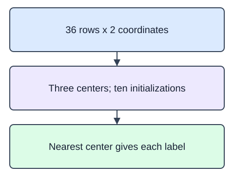

PCA gave each row new coordinates without using target labels. K-means also works without a target, but it assigns rows to groups around learned centers. Fitting alternates between assigning each row to a nearest center and moving each center to its assigned rows' mean. Cluster numbers are just names; cluster 0 is not automatically the cheapest or largest group.

`n_clusters=3` fixes how many groups to fit. `n_init=10` tries ten initializations and keeps the best inertia; `random_state=17` makes this reproducible. The CSV contains 36 two-dimensional synthetic product rows sampled around three compact groups. These dimensionless coordinates illustrate geometry, not measured shopper segments. Features with different units would require a deliberate scaling policy.

`cluster_centers_` contains one row per center. `labels_` contains one assignment per training row, and `predict` assigns new rows to existing centers. `inertia_` is the total squared distance to assigned centers. Smaller inertia can result merely from adding clusters, so it cannot choose the cluster count by itself.

The fitted inertia is

$$
J=\sum_{i=1}^{n}\|x_i-\mu_{z_i}\|_2^2.
$$

Here $n$ is the row count, $x_i$ a row vector, $z_i$ its assigned cluster, and $\mu_{z_i}$ that cluster's center. The norm squared sums squared coordinate differences. Points 1 and 3 assigned to center 2 contribute $(1-2)^2+(3-2)^2=2$. This is squared coordinate units, not a percentage.

The starter runs a comparison baseline. Change `n_clusters` from 2 to 3.

## Dataset

The supplied `pd.read_csv` setup reads that real file and selects named feature columns; the ID column stays outside the model. The numeric indices are dimensionless synthetic measurements, not currency or measured business outcomes. The snapshot is fixed at 2025-01-15; no field is missing.

`product-measurements.csv` has **36 rows**, each representing one synthetic product measurement.

| Column | Meaning | Type / unit | Role or availability |
|---|---|---|---|
| `product_id` | Synthetic product record ID; excluded from predictors | string; none | ID; excluded from predictors |
| `width_index` | Synthetic normalized width coordinate | float; dimensionless | Supplied predictor input |
| `depth_index` | Synthetic normalized depth coordinate | float; dimensionless | Supplied predictor input |

These records are original synthetic HomeHurray teaching data. Feature/ID fields are complete. Missing fields are not allowed in this fixed fixture.

The data tabs are read-only in the editor. Edit `main.py`; the file-reading setup is supplied, not an additional task.

## Your Tasks

1. Fit and return `KMeans` with three clusters, `n_init=10`, and `random_state=17` from `fit_clusters(X)`.

Edit `main.py`, press Run to inspect the supplied checkpoint, then Submit to check the helper. The probe is supplied; you do not need to add printing.
