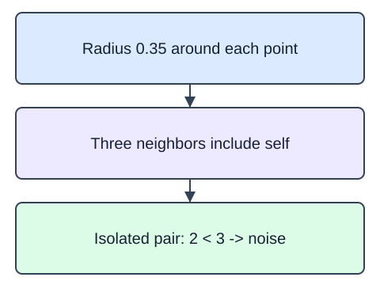

DBSCAN forms groups around dense neighborhoods. `eps` is the neighborhood radius in feature units. `min_samples` counts points in that radius, including the point itself. A core point has enough neighbors; a border point lies near a core point without being core itself. A point unreachable from any core is noise.

`DBSCAN(eps=0.35, min_samples=3, n_jobs=1)` finds two small dense groups and an isolated pair in this supplied geometry. `fit_predict` returns one label per row. Label -1 means noise; other label numbers are arbitrary. Unlike k-means, DBSCAN does not force every row into a group or require a cluster count.

Increasing `eps` can connect groups or absorb noise. Decreasing it can turn more rows into noise. Units and feature scaling therefore matter. The model does not supply a general `predict` method for new rows; this lesson only labels the fitted set. Its synthetic measurements are fixed for illustration, not evidence of anomalies in real orders.

A point $x_i$ is core when

$$
|N_\varepsilon(x_i)|\geq m.
$$

$N_\varepsilon(x_i)$ is the set of fitted points at distance at most $\varepsilon$ from $x_i$, including itself. Vertical bars mean set size; $m$ is `min_samples`. In the editor, $\varepsilon=0.35$ and $m=3$. The first three points are mutually within the radius, so each neighborhood has three points. An isolated point has only itself, and $1<3$.

The starter runs a comparison baseline. Change `min_samples` from 2 to 3; observe the supplied isolated pair to see why the count matters.

These are original synthetic fixtures. The fixed teaching snapshot is 2025-01-15; only declared training partitions may fit state.

### Fixture fields

| Field | Type and units | Role |
|---|---|---|
| `X` | float matrix, two coordinate columns in common arbitrary units | fitted observations; -1 is an output noise label |

## Your Tasks

1. Return labels from `DBSCAN(eps=0.35, min_samples=3, n_jobs=1).fit_predict(X)` in `density_labels(X)`.

Edit `main.py`, press Run to inspect the supplied checkpoint, then Submit to check the helper. The probe is supplied; you do not need to add printing.
