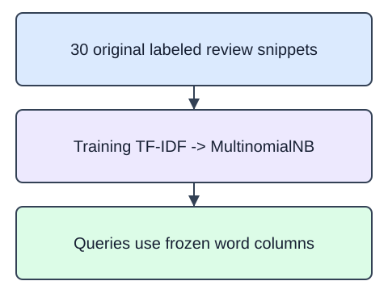

You can now turn text into a sparse feature matrix. Put that transformation before a classifier so training and prediction use the same vocabulary. The pipeline pairs `TfidfVectorizer` with `MultinomialNB`: `fit(training, labels)` learns the vocabulary and class statistics, while `predict(queries)` reuses them on new comments.

Multinomial naive Bayes uses nonnegative feature weights. TF-IDF meets that requirement; centered numeric features may not. `alpha=1.0` adds smoothing to avoid assigning zero probability solely because a word was absent from a class's training text. The model treats features with a conditional-independence approximation; it does not understand the review as a person would.

The demonstration separates assembly comments from delivery comments. The next exercise uses packaging and product-quality wording. All snippets and labels are synthetic. The displayed query predictions are a behavior checkpoint, not a representative accuracy estimate. Unseen tokens cannot grow the vocabulary during prediction.

The starter runs a comparison baseline. Change the naive Bayes smoothing `alpha` from 0.1 to 1.0.

## Dataset

Inspect `reviews.json`: 30 original training snippets and six transform-only query snippets form 36 synthetic HomeHurray records. The supplied `pd.read_json(..., orient="records", convert_dates=False)` setup reads the actual file into a DataFrame. Training/query selections remain Series until they reach the vectorizer. Each record has `review_id` (string ID, excluded from text), `text` (string), and `partition` (`train` or `query`). `topic` holds a synthetic training label; query topics are null because those inputs are unlabeled. All text was authored for this fixed 2025-01-15 teaching snapshot. No scraped customer text is used.

`reviews.json` has **36 rows**, each representing one original text snippet.

| Column | Meaning | Type / unit | Role or availability |
|---|---|---|---|
| `review_id` | Synthetic text record ID; excluded from vocabulary | string; none | ID; excluded from vocabulary |
| `text` | Original description or review snippet | string; none | Only training text may fit vocabulary |
| `partition` | Fixed train/query assignment; never vectorized | string train/query; none | Supplied train/query boundary |
| `topic` | Artificial topic label; null for query rows | string or null; none | Training label; null in queries |

These records are original synthetic HomeHurray teaching data. Feature/ID fields are complete. Only query `topic` values are intentionally null.

The data tabs are read-only in the editor. Edit `main.py`; the file-reading setup is supplied, not an additional task.

## Your Tasks

1. Implement `fit_text_model(training, labels)` as a fitted pipeline with `text` set to `TfidfVectorizer(max_features=100)` and `model` set to `MultinomialNB(alpha=1.0)`.

Edit `main.py`, press Run to inspect the supplied checkpoint, then Submit to check the helper. The probe is supplied; you do not need to add printing.
