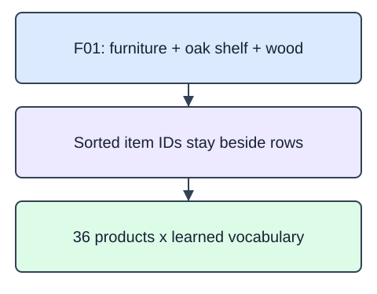

A content-based recommender compares product attributes, not similar users' choices. Give each product one text profile by joining its category, title, and description. Keep `item_id` beside the matrix as an explicit row map; a similarity score has no useful identity without that map.

The input is a pandas DataFrame loaded from the catalog JSON file. Sort rows by their stable string ID, construct the text in that order, then call `TfidfVectorizer(max_features=100).fit_transform(texts)`. Return `(ids, vectorizer, matrix)`. Sorting is an alignment policy, not a feature: IDs must not enter the text. Interactions and outcome labels do not belong in product descriptions either.

All catalog metadata in this illustration was available on 2025-01-01. Fitting the full fixed catalog is allowed in this content setting because those attributes were known before recommendations. It would not be acceptable to add later review outcomes or future catalog edits. The matrix has one row per ID and one column per vocabulary token.

The starter runs a comparison baseline. Use `records.sort_values("item_id")` before constructing texts and IDs.

These are original synthetic fixtures. Catalog fields are available on 2025-01-01.

## Dataset

`catalog.json` contains 36 original synthetic products, with stable IDs and three size variants of twelve designs. Supplied `pd.read_json` setup reads the real file; the function still receives records as its argument. All catalog fields are available on 2025-01-01. Missing fields are forbidden.

`catalog.json` has **36 rows**, each representing one catalog product.

| Column | Meaning | Type / unit | Role or availability |
|---|---|---|---|
| `item_id` | Stable product ID; alignment and ascending tie key, not a text feature | string; none | Product identity / deterministic tie key |
| `category` | Known product category used in catalog text | string; none | Catalog metadata known before history |
| `title` | Original product title used in catalog text | string; none | Catalog metadata known before history |
| `description` | Original product attributes; no user outcomes | string; none | Catalog metadata known before history |
| `available_since` | ISO date that determines catalog eligibility | string; calendar date | Catalog eligibility date |

These records are original synthetic HomeHurray teaching data. Feature/ID fields are complete. Missing fields are not allowed in this fixed fixture.

The data tabs are read-only in the editor. Edit `main.py`; the file-reading setup is supplied, not an additional task.

## Your Tasks

1. Implement `item_profiles(records)` to sort by `item_id`, join only category/title/description row values, and return aligned `(ids, fitted_vectorizer, sparse_matrix)`.

Edit `main.py`, press Run to inspect the supplied checkpoint, then Submit to check the helper. The probe is supplied; you do not need to add printing.
