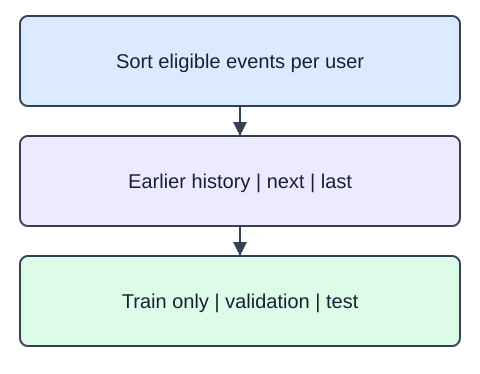

A recommendation should use only the history available when it was made. A random event split can break that rule by training on a later view and testing on an earlier one. Sort each user's eligible events by timestamp. Keep the earlier events as history, the penultimate event for validation, and the last event for testing.

First restrict events to IDs in the catalog available at the chosen cutoff. The helper accepts that already-frozen ID set. Users with fewer than four eligible events are omitted explicitly; the return value includes their IDs under `omitted`. In these fixtures every user-item pair is distinct and dates are unambiguous. Production data would also need a policy for repeated events and timestamp ties.

Return a dictionary containing `train`, `validation`, `test`, and `omitted`. The input is a DataFrame with `user_id`, `item_id`, and `event_at` string columns. ISO date string order matches chronology. `events.itertuples(index=False, name=None)` provides row tuples when building the returned partition lists. The split only partitions data; it does not fit profiles. Later fitting must use `train` alone, including global popularity counts. Per-user chronology does not protect against popularity counts computed from all users' future events.

The starter runs a comparison baseline. Filter each event by `eligible_ids` before adding it to its user's list.

These are original synthetic fixtures. Availability follows the explicit event dates; eligible catalog IDs are fixed before the split.

## Dataset

Inspect `interactions.csv`: six synthetic users have five distinct chronological views each. One short-history user and one unavailable-item event bring the teaching file to 32 rows. `catalog.json` declares twelve item IDs available on 2025-01-01. Supplied file-reading code creates the event DataFrame and eligible ID set; the helper must still filter and partition them.

`catalog.json` has **12 rows**, each representing one catalog product. `interactions.csv` has **32 rows**, each representing one observed synthetic view.

| Column | Meaning | Type / unit | Role or availability |
|---|---|---|---|
| `user_id` | Synthetic user grouping key; not a personal identifier | string; none | History grouping key |
| `item_id` | Stable product ID; alignment and ascending tie key, not a text feature | string; none | Product identity / deterministic tie key |
| `event_at` | ISO event date for the history/holdout boundary | ISO date string; calendar date | Observed view date; history cutoff applies |
| `available_since` | ISO date that determines catalog eligibility | ISO date string; calendar date | Catalog eligibility date |

These records are original synthetic HomeHurray teaching data. Feature/ID fields are complete; an empty history means no observed training views, not dislike. Missing fields are not allowed in this fixed fixture.

The data tabs are read-only in the editor. Edit `main.py`; the file-reading setup is supplied, not an additional task.

## Your Tasks

1. Implement `chronological_holdout(events, eligible_ids)` to filter eligible items, sort within users, omit users with fewer than four events, and return earlier history plus one validation and one test event per eligible user.

Edit `main.py`, press Run to inspect the supplied checkpoint, then Submit to check the helper. The probe is supplied; you do not need to add printing.
