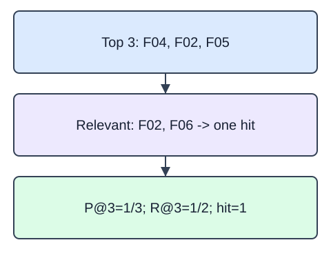

Precision and recall describe different denominators. Precision@k divides the number of relevant recommended items by the requested list length k. Recall@k divides the same hit count by the number of relevant held-out items. Use sets for relevance and never count a duplicated recommendation twice.

Our short-list policy keeps the requested k denominator even when the catalog cannot fill the list. A list with one correct item at k=3 has precision one third, not one. We return `None` when the relevance set is empty, since recall is undefined under this policy. Macro averaging excludes those users and gives every remaining user equal weight.

`topk_metrics` returns `{"precision": ..., "recall": ..., "hit": ...}`. Hit is one when there is at least one relevant recommendation, otherwise zero. With one held-out relevant item per user, recall equals hit, but they differ when a relevance set contains multiple items. A view is only an implicit relevance proxy; an unobserved item is not proven disliked.

Let $h$ be unique hits in the first $k$ positions and $r$ the number of distinct relevant items:

$$
P@k=\frac{h}{k},\qquad R@k=\frac{h}{r}.
$$

$k$ is a positive requested list length; $r$ must be positive. With $h=1$, $k=3$, and $r=2$, precision is $1/3\approx0.3333$ and recall is $1/2=0.5$. Both are unitless. Macro precision over $u$ eligible users is $\frac1u\sum_{j=1}^{u}P_j@k$, where $j$ indexes users. Users with empty relevance sets are omitted, and the eligible count must be reported.

The starter runs a comparison baseline. Use the requested `k`, not returned list length, as the precision denominator.

These are original synthetic fixtures. The fixed teaching snapshot is 2025-01-15; only declared training partitions may fit state.

### Fixture fields

| Field | Type and units | Role |
|---|---|---|
| `ranked` | ordered list of string item IDs | recommended items, possibly short |
| `relevant` | set of string item IDs | held-out implicit relevance proxy |
| `k` | positive integer, items | requested list length |

## Your Tasks

1. Implement `topk_metrics(ranked, relevant, k)` using unique IDs among the first k positions, fixed requested-k precision, relevant-set recall, and binary hit; return `None` for an empty relevance set.

Edit `main.py`, press Run to inspect the supplied checkpoint, then Submit to check the helper. The probe is supplied; you do not need to add printing.
