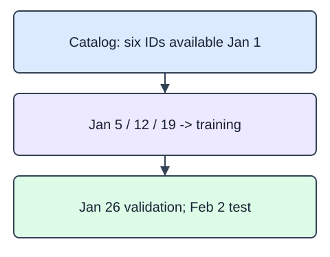

Combine the catalog profiles, ranking rules, and time-aware evaluation in one recommendation project. The full exercise uses 18 synthetic HomeHurray Inc. products and six users, each with five distinct views. This demo starts with a separate six-item, two-user catalog. In both cases, freeze the catalog and event split before building profiles so later stages evaluate the same history.

All metadata was available on 2025-01-01. Training views occur on January 5, 12, and 19. January 26 supplies validation and February 2 supplies the sealed test. `make_catalog()` returns a fresh DataFrame; `split_interactions(catalog, events)` returns DataFrames under `train`, `validation`, and `test`, plus a list of user IDs under `omitted`. The event DataFrame has `user_id`, `item_id`, `event_at`, and `event_type` columns. The supplied project contract requires exactly five distinct eligible items at those five dates; omit a user who fails it.

An eligible product was available by 2025-01-19. Sort each user's eligible events by date, retain the first three as history, and isolate the fourth and fifth. IDs are strings, not model features. The data dictionary in this module's assets specifies fields and availability. The demonstration uses a separate six-item, two-user lighting/frame catalog; the exercise introduces the fixed project fixture.

The runnable demo contains one deliberately different policy. Its availability check currently admits every item. Restrict it to the January 19 cutoff.

## Dataset

The independent analogue loads six products, two users, and ten views from `catalog.json`, `users.csv`, and `interactions.csv`. The supplied readers use `pd.read_json(..., orient="records", convert_dates=False)` for descriptions and `pd.read_csv(..., dtype=str)` for users/events. IDs and ISO dates remain strings; tables stay DataFrames through filtering and grouping. The reference includes byte-identical data files. These files and all completed helpers carry into later project starters; no data is embedded or fetched remotely.

`catalog.json` has **6 rows**, each representing one catalog product. `users.csv` has **2 rows**, each representing one synthetic user. `interactions.csv` has **10 rows**, each representing one observed synthetic view.

| Column | Meaning | Type / unit | Role or availability |
|---|---|---|---|
| `item_id` | Stable product ID; alignment and ascending tie key, not a text feature | string; none | ID; 2025-01-01 |
| `category` | Known product category used in catalog text | string; none | text feature; 2025-01-01 |
| `title` | Original product title used in catalog text | string; none | text feature; 2025-01-01 |
| `description` | Original product attributes; no user outcomes | string; none | text feature; 2025-01-01 |
| `available_since` | ISO date that determines catalog eligibility | string; calendar date | availability; 2025-01-01 |
| `user_id` | Synthetic user grouping key; not a personal identifier | string; none | ID; event timestamp |
| `event_at` | ISO event date for the history/holdout boundary | string; calendar date | availability; event timestamp |
| `event_type` | View, an implicit signal rather than explicit preference | string; none | implicit signal; event timestamp |

These records are original synthetic HomeHurray teaching data. Feature/ID fields are complete; an empty history means no observed training views, not dislike. Missing fields are not allowed in this fixed fixture.

The data tabs are read-only in the editor. Edit `main.py`; the file-reading setup is supplied, not an additional task.

The availability stress probe makes a separate catalog copy with a late item; the canonical file is unchanged.

## Your Tasks

1. Implement `split_interactions(catalog, events)` under the exact five-date contract, returning three training events plus one validation and one test event per eligible user, with invalid users listed in `omitted`.

Edit `main.py`, press Run to inspect the supplied checkpoint, then Submit to check the helper. The probe is supplied; you do not need to add printing.
