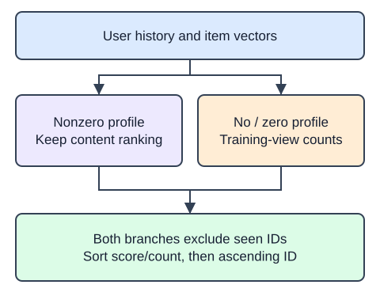

The warm-user ranker is complete. Add `recommend_with_fallback` as a wrapper rather than rewriting that function. A usable content ranking should return unchanged. If history is absent or its profile is zero, rank the eligible unseen catalog by training-view count, then ascending item ID for equal counts.

The wrapper receives only `training`; it must not read validation or final-test events from the full fixture. `Counter(training["item_id"])` counts item views across all training users. Include catalog products with count zero so the fallback can fill k where enough candidates exist. Seen filtering applies to both branches.

A zero profile differs from an empty history: the zero-profile user may still have seen IDs that must be excluded. The hidden checks exercise both cases by supplying a zero matrix and by supplying an unknown user. Popularity can overexpose already common products. It is a declared fallback and comparison baseline, not a claim about individual preference.

The runnable demo contains one deliberately different policy. Its wrapper currently forces the fallback for every user. Restore the warm-user branch.

## Dataset

The independent analogue loads six products, two users, and ten views from `catalog.json`, `users.csv`, and `interactions.csv`. The supplied readers use `pd.read_json(..., orient="records", convert_dates=False)` for descriptions and `pd.read_csv(..., dtype=str)` for users/events. IDs and ISO dates remain strings; tables stay DataFrames through filtering and grouping. The reference includes byte-identical data files. These files and all completed helpers carry into later project starters; no data is embedded or fetched remotely.

`catalog.json` has **6 rows**, each representing one catalog product. `users.csv` has **2 rows**, each representing one synthetic user. `interactions.csv` has **10 rows**, each representing one observed synthetic view.

| Column | Meaning | Type / unit | Role or availability |
|---|---|---|---|
| `item_id`, `user_id` | Product alignment / user history grouping | strings; no unit | IDs, not predictors; ascending item-ID ties |
| `category`, `title`, `description` | Original product content | strings; no unit | Text features known on 2025-01-01 |
| `available_since`, `event_at` | Catalog availability / view chronology | ISO date strings | Catalog Jan 1; history Jan 5/12/19; validation Jan 26; test Feb 2, 2025 |
| `event_type` | View, an implicit relevance proxy | string; none | Available only when the event occurs |

These records are original synthetic HomeHurray teaching data. Feature/ID fields are complete; an empty history means no observed training views, not dislike. Missing fields are not allowed in this fixed fixture.

The data tabs are read-only in the editor. Edit `main.py`; the file-reading setup is supplied, not an additional task.

## Your Tasks

1. Implement `recommend_with_fallback(ids, matrix, training, user, k=3)` to preserve warm rankings and use training-only popularity for absent or zero profiles, with the same seen filtering and ID tie policy.

Edit `main.py`, press Run to inspect the supplied checkpoint, then Submit to check the helper. The probe is supplied; you do not need to add printing.
