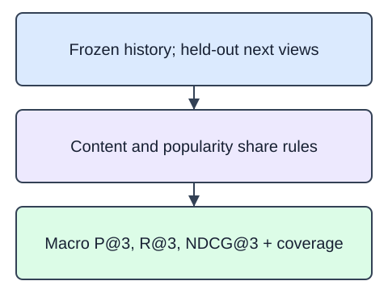

Evaluate the frozen model against held-out next views. The completed catalog, split, content ranker, and fallback are already in the starter. Implement one report function that compares content recommendations with training-only popularity using the same eligible catalog and seen exclusions.

For each eligible user, precision is hits divided by the requested k, recall is hits divided by the distinct eligible held-out relevance count, hit is whether any hit occurred, and binary NDCG discounts hit positions. Average each metric across eligible users, giving each user equal weight. Omit users without training history or without unseen eligible relevance and report their IDs. A shorter list still uses k for precision. Catalog coverage is the number of distinct recommended IDs divided by catalog size.

`evaluate(ids, matrix, training, heldout, k=3)` returns counts and nested `content` and `popularity` metrics. Required top-level keys are `k`, `users`, `omitted`, `catalog_items`, `training_events`, `heldout_events`, and `frozen_history`. Each nested report contains `precision`, `recall`, `hit`, `ndcg`, and `coverage`. The full project exercise has six eligible users; this demonstration has two. Each has one relevant item per user in either held-out split, so recall and hit coincide here but not for every input.

The supplied probe prints validation and final-test reports separately with k fixed at three. Do not choose settings after reading final-test results. Do not append validation events before testing: this is a fixed-state evaluation, so validation-viewed items remain eligible at test. It is not an online retraining simulation. A view is an implicit relevance proxy; missing views do not establish dislike. Six synthetic users cannot establish commercial quality, and the report must not promise an improvement over popularity.

The runnable demo contains one deliberately different policy. Its recall calculation currently uses binary hit. Divide hits by the eligible relevance count instead.

## Dataset

The independent analogue loads six products, two users, and ten views from `catalog.json`, `users.csv`, and `interactions.csv`. The supplied readers use `pd.read_json(..., orient="records", convert_dates=False)` for descriptions and `pd.read_csv(..., dtype=str)` for users/events. IDs and ISO dates remain strings; tables stay DataFrames through filtering and grouping. The reference includes byte-identical data files. These files and all completed helpers carry into later project starters; no data is embedded or fetched remotely.

`catalog.json` has **6 rows**, each representing one catalog product. `users.csv` has **2 rows**, each representing one synthetic user. `interactions.csv` has **10 rows**, each representing one observed synthetic view.

| Column | Meaning | Type / unit | Role or availability |
|---|---|---|---|
| `item_id`, `user_id` | Product alignment / user history grouping | strings; no unit | IDs, not predictors; ascending item-ID ties |
| `category`, `title`, `description` | Original product content | strings; no unit | Text features known on 2025-01-01 |
| `available_since`, `event_at` | Catalog availability / view chronology | ISO date strings | Catalog Jan 1; history Jan 5/12/19; validation Jan 26; test Feb 2, 2025 |
| `event_type` | View, an implicit relevance proxy | string; none | Available only when the event occurs |

These records are original synthetic HomeHurray teaching data. Feature/ID fields are complete; an empty history means no observed training views, not dislike. Missing fields are not allowed in this fixed fixture.

The data tabs are read-only in the editor. Edit `main.py`; the file-reading setup is supplied, not an additional task.

The extra five-item probe has two relevant items for one user so recall differs from binary hit. It does not alter the frozen project data.

## Your Tasks

1. Implement `evaluate(ids, matrix, training, heldout, k=3)` to return the declared macro metric report for content and popularity with identical exclusions, explicit eligible-user counts, and frozen training state.

Edit `main.py`, press Run to inspect the supplied checkpoint, then Submit to check the helper. The probe is supplied; you do not need to add printing.
