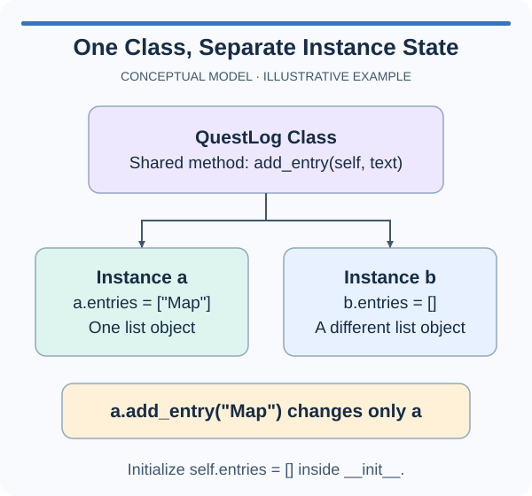

# Independent instance lists

Playtesters can leave notes about individual items. A lantern's notes should not appear on a shield, even though both objects use the same class. Create each notes list inside the initializer so every instance owns its collection.

## One list or many lists

A class body runs when Python defines the class, not once for every instance. A list created there is therefore one shared object. Calling `append` changes that list; it does not create an instance override just because you accessed the list through an instance.

A separate example creates individual quest journals correctly:

```python
class Explorer:
    def __init__(self, name):
        self.name = name
        self.discoveries = []

lee = Explorer("Lee")
sam = Explorer("Sam")
lee.discoveries.append("tower discovered")
print(sam.discoveries)  # []
```

The `[]` expression runs each time `__init__` runs. The two `discoveries` attributes refer to different lists, so appending through `lee` does not change Sam's list.

This differs from reading a shared integer default. Integers cannot be changed in place: adding to an integer attribute stores a new value. Lists can be mutated in place, and every reference to that list sees the mutation. You therefore need to decide who should own the collection.

Also avoid using `notes=[]` as an initializer parameter default for this task. Default argument expressions run when the function is defined, not at each call. That would introduce another way to share one mutable list accidentally.

The starter already initializes the item's name and supplies an `add_note` method. The missing piece is the collection that method appends to. Create it even when an item has no notes yet; an empty list is useful data, not an error. The probe adds a note to one item and prints both collections so shared storage cannot hide behind a plausible first result.

## Picture the behavior

The diagram uses an independent `QuestLog` example: each log owns its `entries` list, and `add_entry` changes only that log. Your items need the same separation for their playtest notes.



## Your Tasks

1. Initialize a fresh empty `notes` list on every `GameItem` instance inside `__init__`, so the supplied `add_note` method never changes another item's notes.

## Run and check

Edit `main.py`. Press **Run** to inspect the supplied console probe, then **Submit** to check your implementation. Only the lantern should contain `glow checked`; the shield should show `[]`.
