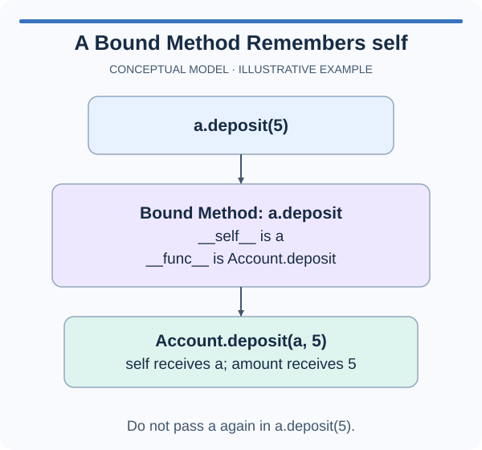

# Bound methods

The workshop schedules an operation to run later. Instead of calling a tool method immediately, save the method itself. The saved value remembers which tool should receive the eventual call.

## Accessing is different from calling

```python
class Bell:
    def __init__(self, sound):
        self.sound = sound

    def ring(self):
        return self.sound

bell = Bell("ding")
action = bell.ring
print(action())  # ding
```

`bell.ring` has no parentheses. It retrieves a **bound method**, a callable value that combines the method's function with the instance `bell`. Later, `action()` invokes that function with `bell` supplied as `self`.

By contrast, `action = bell.ring()` calls the method immediately and saves its returned string. A string is not the pending operation. This distinction matters when handing work to menus, schedulers, or ordinary functions that will call it later.

A bound method remembers the object, not a frozen copy of its attributes. If you change `bell.sound` before calling `action`, the method reads the changed sound. Two bells produce bound methods attached to different receivers even though they share the same method definition.

You can also access the function through the class. For this ordinary instance method, `Bell.ring(bell)` explicitly supplies the receiver that `bell.ring()` supplies automatically. Usually the instance-call form is clearer, but the comparison explains where `self` comes from.

The supplied `Tool.record_use` changes a count and returns the updated count. Complete `deferred_use(tool)` so it returns that tool's bound method without running it. The probe prints the count before calling the saved operation, then prints the result afterward. If the first count has already increased, the operation happened too early.

## Picture the behavior

The diagram uses a separate account example. Its `__self__` attribute identifies the receiving object, and `__func__` identifies the original function. These names let you inspect a bound method; you do not need to set them.



## Your Tasks

1. Complete `deferred_use(tool)` to return the bound `record_use` method of the supplied tool without calling it.

## Run and check

Edit `main.py`. Press **Run** to inspect the supplied console probe, then **Submit** to check your implementation. The completed probe prints a count of `3` before the action and `4` afterward.
