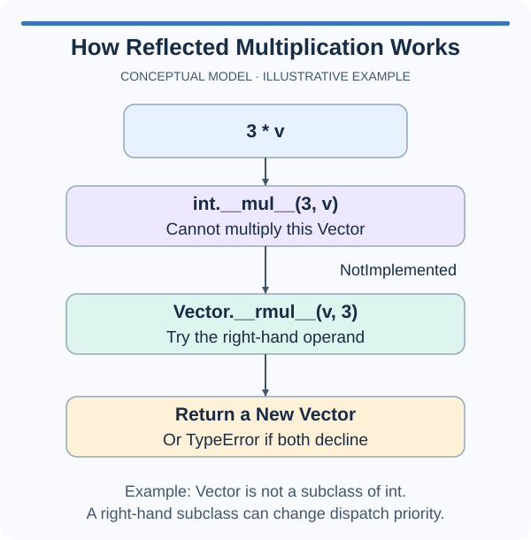

# Support reflected multiplication

A caller naturally writes either `pack * 3` or `3 * pack`. The previous lesson implemented only the first form. This time the regular multiplication method is supplied, and your task is to make the reversed spelling follow exactly the same policy.

When an integer cannot multiply a custom object, Python can ask the custom object's `__rmul__` method to handle the operation. The letter r means reflected. The object is still `self`; the other operand arrives as the method's argument. Reflected dispatch is how a class cooperates with types it does not control. You do not need to edit Python's integer class.

Our `TokenPack.__mul__` already creates a new pack and accepts exact integers only. Reusing that method from `__rmul__` avoids maintaining a second copy of the type check and calculation. Delegation means asking an existing operation to do the work, then returning its result. It also carries the existing `NotImplemented` behavior into the reflected path.

Do not implement the reflected method by writing the same reversed expression again. An expression such as `factor * self` inside `__rmul__` requests the operation that led into the method and can recurse repeatedly. Call the existing method directly instead. Recursion means a function calls itself, directly or indirectly; an endless chain eventually raises an error rather than producing a pack.

The example uses a named convenience method to delegate a measurement calculation. Its second method does not duplicate the arithmetic. Apply that relationship to the two multiplication hooks in the starter.

After editing, compare the counts from both operand orders and check that the source count stays unchanged. The tests also use zero and a negative factor, because delegating correctly should preserve the whole contract rather than only the visible sample.

## A small example

```python
class Rectangle:
    def __init__(self, width, height):
        self.width, self.height = width, height

    def area(self):
        return self.width * self.height

    def square_units(self):
        return self.area()

print(Rectangle(3, 8).square_units())
```

## Picture the behavior

This diagram traces the same dispatch rule with a vector. `NotImplemented` lets Python try another supported route; it is different from raising `NotImplementedError`.



## Your Tasks

1. Implement `TokenPack.__rmul__` by delegating to the supplied `__mul__`, so exact integer factors work on either side and unsupported factors return `NotImplemented`.

Edit `main.py`, then press Run to inspect the supplied probe. A `Not ready` message means the unfinished operation raised an exception; it does not complete the task. Press Submit to check the behavior with additional values. You do not need to edit the probe.
