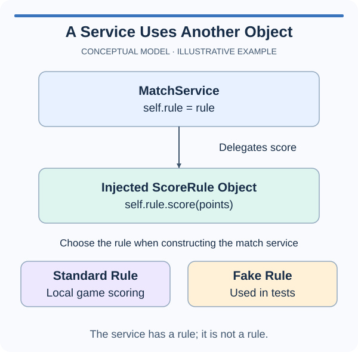

# Compose a service from a collaborator

A notice board uses a formatter, but it is not itself a formatter. Composition models that has-a relationship: store a collaborator on the board and ask it to perform its part of the work. This makes formatting replaceable without building a new inheritance tree.

The supplied `NoticeBoard` initializer receives a formatter object and stores it as `self.formatter`. Passing a dependency into an object instead of constructing it internally is often called dependency injection. Here it is just an ordinary constructor argument. The benefit is concrete: the caller can supply a different formatter while the board keeps the same publishing behavior.

Your publishing method should ask the stored collaborator to format the incoming text and pass its result back to the caller. The board does not need to know the formatter's concrete type or how it builds the text. It only relies on the small interface: a `format` method accepting one text argument and returning a string.

The example shows a playlist containing a speaker. The playlist calls a method on that separate object; it does not inherit from the speaker. Notice the two dots in `self.speaker.play(title)`: first retrieve the collaborator, then call its behavior. The exercise uses that same relationship with text formatting rather than playback.

Inheritance is still useful when a specialized object can stand in for its base. Composition is useful when responsibilities are separate or the collaborator may vary independently. Do not make `NoticeBoard` a subclass of its formatter simply to reach the `format` method.

The tests pass different collaborators and replace one on an existing board. They also count calls to detect duplicate formatting. Do not create a new `BracketFormatter` inside `publish`, because doing so would ignore the supplied dependency and make replacement ineffective. The returned message should come directly from the current collaborator.

## A small example

```python
class Speaker:
    def play(self, title):
        return f"Playing {title}"

class Playlist:
    def __init__(self, speaker):
        self.speaker = speaker

    def start(self, title):
        return self.speaker.play(title)

print(Playlist(Speaker()).start("Rain"))
```

## Picture the behavior

The diagram uses a checkout helper to show the same relationship. Your notice board delegates formatting rather than charging; neither object needs to inherit from its helper.



## Your Tasks

1. Implement `NoticeBoard.publish(text)` to call the current formatter's `format(text)` exactly once and return its result. Use the injected collaborator instead of constructing or inheriting a formatter.

Edit `main.py`, then press Run to inspect the supplied probe. A `Not ready` message means the unfinished operation raised an exception; it does not complete the task. Press Submit to check the behavior with additional values. You do not need to edit the probe.
