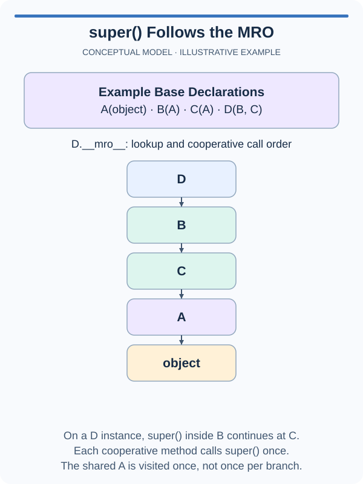

# Cooperate through a diamond

A Lantern Vale sprite build should record its glow, trail, and shared entity steps once each. Calling both parents directly could visit the common ancestor twice. Complete the cooperative method so the MRO chooses the next step.

`super()` does not mean a permanently fixed parent. Within `GlowMixin`, it means continue after `GlowMixin` in the actual instance's MRO. For a plain `GlowMixin` instance, the next class is `Entity`. For `LanternSprite(GlowMixin, TrailMixin)`, the next class is `TrailMixin`, which then continues to `Entity`. The current instance travels through the whole chain; Python does not create separate parent instances.

Every participating method must use a compatible signature and forward the same agreed arguments. Here all `build` methods accept `self, events`; `events` is one shared list, and each method appends its own label before delegating. The root method terminates the chain because `object` has no `build` method. This deliberately narrow signature avoids introducing keyword-consumption patterns before they are needed.

The example uses ordinary functions to show ordered forwarding with a shared list. The exercise replaces that explicit function relationship with cooperative method lookup. Append before calling onward to get outer-to-inner order. Calling onward first would reverse the position of that method's event.

Your task changes only `GlowMixin.build`; the other participants already cooperate. Do not call `Entity.build` or `TrailMixin.build` by name. A fixed call would skip or repeat work when the same mixin appears in a different hierarchy. Call the next implementation once and return its result.

The tests use the sprite, a plain GlowMixin instance, and a reversed sibling order. This exposes hardcoded routes that happen to fit one diamond. No initializer chain is involved here: the lesson isolates cooperative method signatures and lookup before adding stateful construction complexity.

## A small example

```python
def finish(events):
    events.append("finished")
    return events

def prepare(events):
    events.append("prepared")
    return finish(events)

print(prepare([]))
```

## Picture the behavior

This smaller diamond uses letter names to make the lookup order visible. The arrows show the order of lookup, not direct parent relationships. Your sprite chain stops at its root `build` method, before `object`, which has no `build`.



## Your Tasks

1. Implement `GlowMixin.build(events)` to append `glow`, call the next `build(events)` through `super()` exactly once, and return that call's result. It must cooperate in both sibling orders and when used alone.

Edit `main.py` and use Run to inspect the supplied check. Leave that check unchanged; Submit tests your method with other values too.

You have now used inheritance, composition, and cooperative methods with Lantern Vale objects. After the quiz, the animal rescue project uses the same ideas in a different setting: shared animal behavior, specialized species, and a care report.
