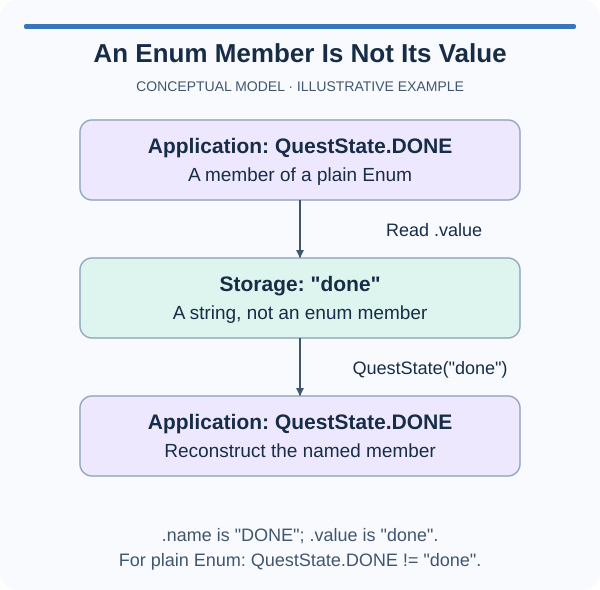

A delivery service sends numeric codes to another program. Those codes belong in an explicit enum definition, where inserting a new member cannot renumber existing codes.

Write the required code on the right side of each assignment. Python does not require consecutive integers. A value can also be a string, tuple, or another object. For example, a tuple can group a unit label and a conversion factor. The member remains an enum member even when its value contains several pieces of data.

The two lookup forms answer different questions. `Route["LOCAL"]` looks up a member by its name; `Route(12)` looks up a member by its value. Calling the enum this way retrieves an existing member rather than creating a new one. A missing name raises `KeyError`, whereas an unknown value raises `ValueError`.

The example's values are deliberately spaced apart. A persisted code should keep its meaning even if you rearrange the source. Use automatically generated values only when the actual codes do not form an external contract; that is the next lesson.

Structured values are allowed, but a mutable list or dictionary is a poor choice for a fixed specification if later code can change it. Prefer immutable values when possible. This exercise uses integers so the relationship between a member and its external code stays easy to inspect.

The starter already has both names. Your edit changes their codes, not the probe or the enum's base class.

## A small example

```python
from enum import Enum

class Route(Enum):
    LOCAL = 12
    EXPRESS = 48

print(Route(48).name)
print(Route["LOCAL"].value)
```

## Picture the behavior

The diagram uses a string code instead of a numeric one. The member, its name, and its stored value remain distinct.



## Your Tasks

1. Change `ParcelCode` so `ACCEPTED` has value `202` and `MISSING` has value `404`.

Edit `main.py`, then press Run to inspect the supplied probe. Submit checks the task with additional cases. You do not need to change the probe.
