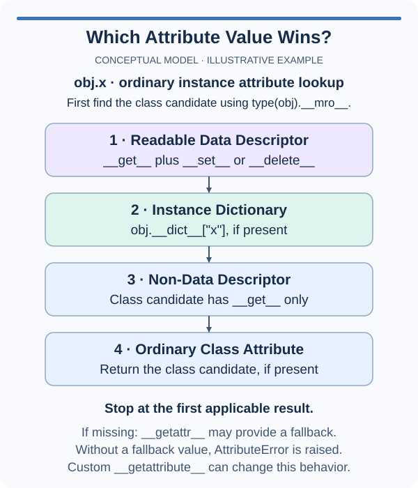

A generated greeting should be a default, not a restriction. Let an individual player profile replace it with a custom message while untouched profiles keep the computed greeting.

A descriptor that defines `__get__` but neither `__set__` nor `__delete__` is a non-data descriptor. On ordinary instance access, an instance dictionary entry with the same name takes priority over that descriptor. Without such an entry, Python invokes the getter found on the class.

This priority makes a getter useful as an overridable default. Assigning to the public attribute stores an instance entry because there is no descriptor setter to intercept the assignment. Deleting that entry later reveals the class-level descriptor again. The descriptor itself remains in the class dictionary throughout.

The example demonstrates this with a fixed fallback. One instance first sees the getter's value, then its own override, then the fallback again after deletion. That is different from the preceding lesson's read-only data descriptor, whose getter wins even if a public-name entry exists in the instance dictionary.

Do not add an empty setter to a descriptor that is meant to be overridable. Even a setter that does nothing changes its classification and therefore changes lookup priority. The protocol is determined by methods on the descriptor's type, not by the intent of a comment.

The supplied exercise contains only a getter. Complete its computed default and leave its non-data structure intact. A player's name may change, so the getter should use the current `instance.name` each time rather than store a greeting on the shared helper.

## A small example

```python
class Fallback:
    def __get__(self, instance, owner):
        return "standard"

class AvatarStyle:
    label = Fallback()

style = AvatarStyle()
print(style.label)
style.label = "personal"
print(style.label)
del style.label
print(style.label)
```

## Picture the behavior

The lookup order below assumes ordinary instance attribute access. Python first finds the class candidate through the MRO, then applies these priorities.



## Your Tasks

1. Complete the getter-only `Greeting` descriptor so its default is `"Hello, "` followed by the player's current name; preserve normal per-instance overrides of `greeting`.

Edit `main.py`, then press Run to inspect the supplied probe. Submit checks the task with additional cases. You do not need to change the probe.
