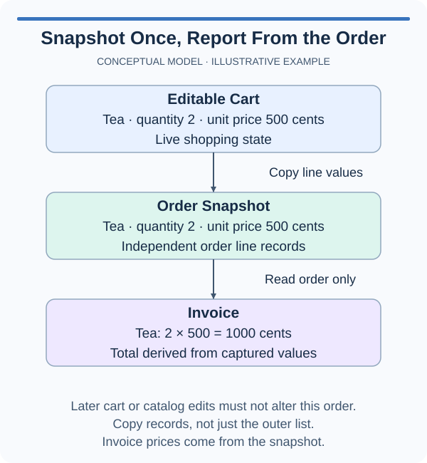

# Freeze an order snapshot

Capture a purchase so later cart edits cannot rewrite the order.

An order is a record of what was purchased, not a live view of the cart. The supplied frozen Order stores rows as a tuple of tuples. These rows contain only strings and integers, so the nested values are immutable too. Copy the summary into that shape; do not retain CartLine objects. The status belongs to later tracking code, because purchase details should not change when delivery progresses.

A frozen dataclass does not recursively freeze arbitrary objects. A list stored inside one could still be mutated. This order avoids that problem by storing a tuple whose row tuples contain only immutable values. The cart summary already supplies those row values, so you only need to freeze its outer collection.

## A smaller example

The measurement tuple survives after its source list is cleared.

```python
measurements = [("north", 12), ("south", 9)]
snapshot = tuple(measurements)
measurements.clear()
print(snapshot)
```

## Picture the behavior

The invoice is a later consumer of this snapshot. Capturing the order now means that future reports can use the purchase values instead of the current cart.



## Your Tasks

1. Implement `snapshot_order(order_id, cart)` to return the supplied frozen `Order` with `order_id`, a tuple of summary rows, and the summary total. Later additions or removals must not affect the order.

## Run and check

Edit `main.py`, then press **Run**. The supplied probe catches unfinished-code errors so you can inspect the Console before submitting. An empty snapshot is allowed here; checkout will reject an empty purchase in the next lesson. Press **Submit** to check the behavior with other inputs.
