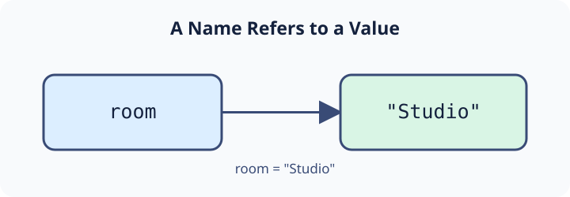

When you're creating a program, you might be doing it so that you can perform some kind of calculations. For example, given a birthday and current date, you may want to calculate the age of the person or given two numbers, you may want to add those numbers in your calculator application. All these applications require a way to store given inputs and the result of those calculations. This is where variables come in.

A variable is a name referring to a value. The arrow shows `room` pointing at a separate string, not holding its letters.



`room = "Spawn Camp"` assigns a location in memory and puts a value "Spawn Camp" in it. Variable names are case-sensitive, so `room` is different from `Room` or `ROOM`. Also variable names cannot begin with a digit, and cannot contain spaces. If you want to print a variable value, you can simply print with the name of the variable like this.

```python run
room = "Spawn Camp"
print(room)
```

In Python, it is standard practice to use  `snake_case` for variable names. That means each word in the variable are separated by underscores (`_`). Also, make it a habit to create meaningful names for your variables depending on what it is storing. 

Below are some bad names for variables.

```python
a = "Good morning"
n = "Eddie"
```

The names `a` and `n` don't carry any clear meaning. Instead of that, use meaningful names for your variables.

```python run
greeting = "Good morning"
name = "Eddie"
print(greeting, name)
```

## Formal Definition

Formallly, creating a variable is also called defining a variable and then when you put a value for the first time in a variable. That is called as variable initialization. In some programming languages, there were two different steps in this process. First, you would define a variable and then you would initialize it. But in Python, you can do both in one step.

## Your Tasks

1. Set `room` to `"Beacon Ridge"` while keeping print statement at the end. Click **Run** to verify your results and **Submit**.
