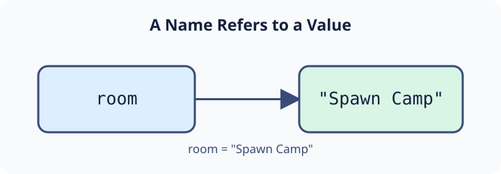

Programs need to remember information. A calculator needs its input numbers and result; a map needs the name of the current location. A **variable** gives a value a name so you can use it again.

The assignment `room = "Spawn Camp"` makes the name `room` refer to the string `"Spawn Camp"`. In the diagram, the name and value are separate: the arrow shows the reference between them.



To display the value, pass the variable name to `print()` without quotes:

```python run
room = "Spawn Camp"
print(room)
```

Run the example. It prints `Spawn Camp`, not `room`. Writing `print("room")` would print the word itself.

## Choose a useful name

Names are case-sensitive: `room`, `Room`, and `ROOM` are different names. A name cannot start with a digit or contain spaces. For names with several words, Python programmers usually use **snake_case**, such as `current_room`.

Short names like these give a reader little help:

```python
a = "Good morning"
n = "Eddie"
```

The following names explain the values. Run the example to see that `print()` can display two values, separated by a space.

```python run
greeting = "Good morning"
name = "Eddie"
print(greeting, name)
```

You may hear the terms *defining* and *initializing* a variable. The first assignment introduces the name and gives it an initial value in one step. A later assignment can make that same name refer to a different value.

In **main.py**, the print call is already supplied. Leave it in place and change the location assignment. Press **Run** to see `Beacon Ridge`, then **Submit**.

## Your Tasks

1. Set `room` to `"Beacon Ridge"`.
