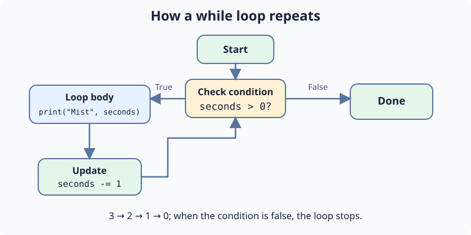

A beacon needs several pulses before it becomes steady. Instead of writing a separate print call for each pulse, the starter repeats a small block of code with **while**.

Before every repetition, Python checks `pulses > 0`. If it is true, the indented body prints the current count and subtracts one. `pulses -= 1` is a shorter way to write `pulses = pulses - 1`.

When the count reaches zero, the condition is false. Python leaves the loop and runs the unindented `print("Beacon steady")`.

Run the starter to see `Pulse 3`, `Pulse 2`, `Pulse 1`, and `Beacon steady`. Then change the starting count in **main.py** and press **Run** again. This time, `Pulse 4` should appear first. Use **Submit** to check the edit.

Keep the subtraction inside the loop. Without it, the count would stay positive and this loop would keep running.

## Your Tasks

1. Start `pulses` at `4`.
