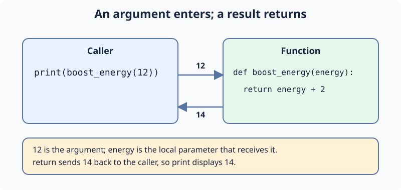

# Pass Energy and Return a Result: Demo

The welcome function always did the same thing. A function can also accept a value and work with it.

In `boost_energy(10)`, `10` is the **argument**: the value you pass in. Inside the function, the **parameter** `energy` is the name for that value. The function adds two, then `return` sends the result back to the caller.

Notice that `return` doesn't display anything. The outer `print(...)` displays the returned number. Run the starter to see `12`.

## Your Tasks

1. Change the argument in the supplied print call from `10` to `12`.

Run again: the result should now be `14`. Submit to check your change. The next exercise asks you to write a calculation that accepts two inputs.
