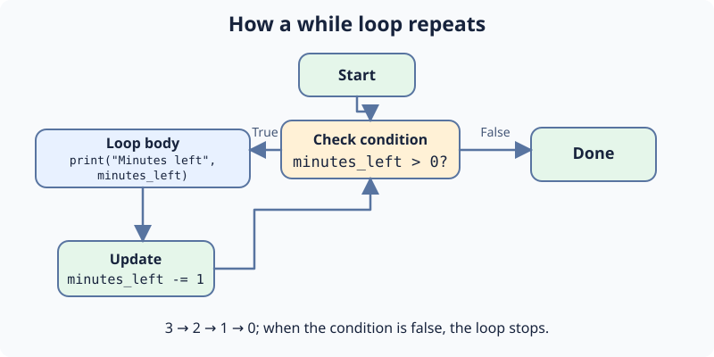

In the previous section, a condition helped your program choose what to do once. Now a kitchen timer needs to print its remaining minutes repeatedly. Instead of writing one print call per minute, `while` repeats an indented block while its condition is true.

Before each turn, Python checks `minutes_left > 0`. The body prints the count and subtracts one. `minutes_left -= 1` means `minutes_left = minutes_left - 1`. At zero, Python skips the body and runs the unindented `print("Timer done")`.

The starter prints `Minutes left 3`, `Minutes left 2`, `Minutes left 1`, then `Timer done`, each on a new line.

## Your Tasks

1. Start `minutes_left` at `4`, so the countdown begins with `Minutes left 4`.

Edit `main.py`, press **Run**, then **Submit**. Keep the subtraction inside the loop or the timer will never reach zero.
