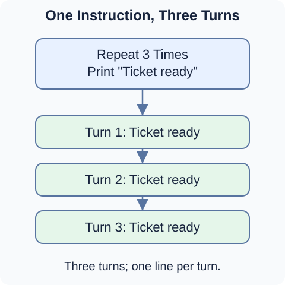
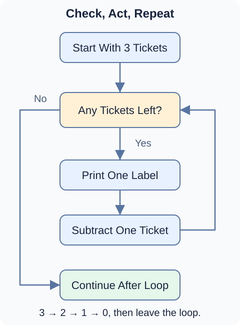

A printer needs to produce three ticket labels. You already know how to print a message, so you could write:

```python
print("Ticket ready")
print("Ticket ready")
print("Ticket ready")
```

This works, but what if you need 100 labels? Copying the same instruction 100 times would make the program longer without teaching it anything new.

A **loop** tells a program to repeat a block of instructions. You write the action once and describe how the program should repeat it. Printing labels, counting down a timer, and checking each attendee at an event are all jobs a loop can help with.

## Describe the repetition first

Before worrying about Python's exact syntax, write the plan in ordinary words:

```text
REPEAT 3 TIMES:
    PRINT "Ticket ready"
```

This is **pseudocode**: a way to sketch a program's steps without following a programming language's exact rules. These text examples describe a plan; they are not Python code to run.

The indented instruction belongs to the repeated block. Here, that block has just one instruction, but a loop can repeat several instructions together.



Each pass through the repeated block is called an **iteration**, or one turn of the loop. Three iterations produce three lines of output. The repeated block is the **loop body**.

A loop does not make three things happen at the same instant. It completes one turn, then moves on to the next.

## Give the loop a way to finish

We can describe the same printing job by keeping track of how many tickets remain:

```text
SET tickets_left TO 3
WHILE tickets_left IS GREATER THAN 0:
    PRINT "Ticket ready"
    SUBTRACT 1 FROM tickets_left
PRINT "Labels finished"
```

Read this plan in order:

1. **Start:** three tickets need labels.
2. **Check:** is there at least one ticket left? If not, leave the loop.
3. **Act:** print one label.
4. **Update:** subtract one because that ticket is now done.
5. **Repeat:** return to the check before printing another label.

The last print instruction is not indented. It is **after the loop**, so it runs once when the repeated work is finished.



Follow the changing count:

| Tickets before check | What happens? | Tickets afterward |
| --- | --- | --- |
| 3 | Print one label | 2 |
| 2 | Print one label | 1 |
| 1 | Print one label | 0 |
| 0 | Leave the loop | 0 |

The program prints `Ticket ready` three times, then `Labels finished` once. If the count started at zero, it would skip the loop body and print only `Labels finished`.

For this plan to finish, the count must move toward zero. Without the subtraction, the count would stay at three and the condition would stay true. That would be an **infinite loop**: repetition with no stopping point reached.

## How is this different from if?

You used `if` in the previous section to choose whether to run a block. After that block, the program moves on.

A loop can return to its check and run its body again. That return path is what lets one short block do repeated work.

## Two ways Python repeats work

Python gives you two main loop statements:

- **`while`** repeats a block while a condition is true. You will start with a countdown whose changing count eventually reaches zero.
- **`for`** visits values one at a time and runs a block for each value. Later, you will use it to work through a sequence of day numbers.

You do not need to memorize either syntax yet. First, get comfortable asking: **What repeats, what changes between turns, and when is the work finished?**

In the next lesson, you will turn this check–act–repeat idea into your first Python `while` loop.
