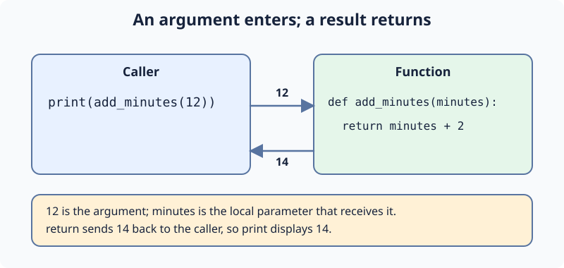

# Pass minutes and return a result

Suppose a meeting runs two minutes longer than planned. A function can accept the planned duration and return the revised duration.

In `add_minutes(10)`, `10` is the **argument** passed by the caller. Inside the function, `minutes` is the **parameter** that receives it. `return` sends `minutes + 2` back to the caller.

Run the starter to see `12`. The function's `return` does not display anything by itself; the surrounding `print(...)` displays the value.

## Your Tasks

1. Change the argument in the supplied print call from `10` to `12`.

Run again to see `14`, then Submit. The next exercise uses two inputs instead of one.
