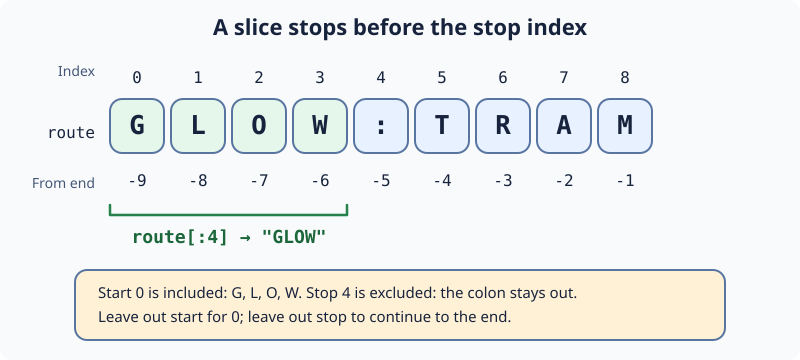

# Slice a Cavern Route: Demo

One character isn't enough to read the route name in `GLOW:TRAM`. A **slice** reads a stretch of characters instead.

The pattern is `text[start:stop]`. Python includes the character at `start` and stops before the character at `stop`. Leaving out `start` means "begin at zero."

The starter uses `route[:2]`, so Run prints `GL`. The colon in the string is at index `4`; it doesn't belong in the route name.

## Your Task

1. Change the slice assigned to `district` so it reads `GLOW` from `route`.

Run `main.py` to check that the colon is left out, then Submit. Unlike a single index, a slice can extend past the end of a string: Python returns the available characters rather than raising `IndexError`.
