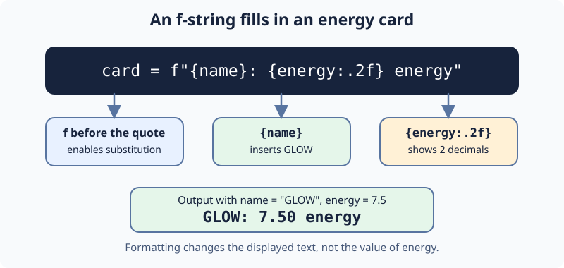

# Format a Route Card: Demo

The route card already contains a name and an energy amount. Give the amount a consistent format so `7.5` appears as `7.50`.

An **f-string** has an `f` before its opening quote. Expressions inside braces supply the values: `{name}` inserts the name, and `{energy:.2f}` displays the energy with two digits after the decimal point.

The formatting changes the text on the card, not the number stored in `energy`.

## Your Task

1. Update the f-string assigned to `card` so it displays `energy` to two decimal places.

Keep the name and the word `energy` in the card. Run `main.py` to see `GLOW: 7.50 energy`, then Submit.
