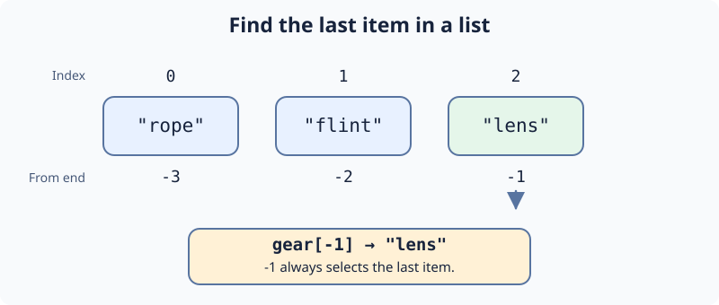

Welcome to Inventory Ridge. You have a route; now you need an ordered list of gear. Python lists use the same index positions you saw with strings: `0` selects the first item and `-1` selects the last.

`len(gear)` tells you how many items the list holds. An index outside the list raises `IndexError`.

The starter reads the first item. Edit `main.py` to read the last one instead. Press Run and look for `lens`, then Submit to check your change.

## Your Task

1. Set `last_gear` to the last item of `gear`.
