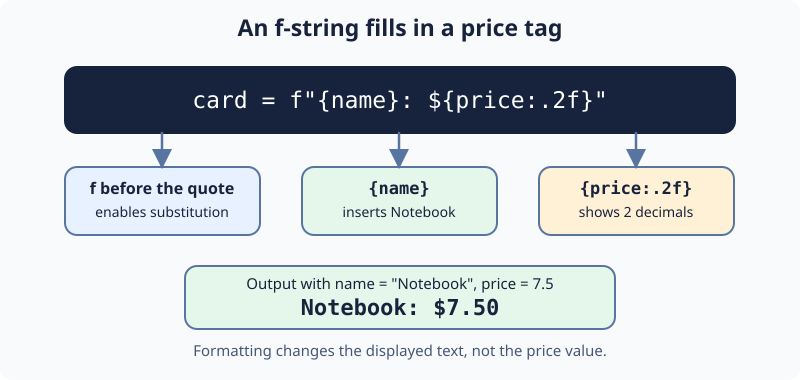

# Format a price tag

A price tag has a product name and a dollar amount. Display `7.5` as `$7.50` so the amount reads like a price.

An **f-string** starts with `f` before the quote. Braces insert values: `{name}` inserts the product name, and `{price:.2f}` displays the price with two digits after the decimal point.

The formatting changes the displayed text, not the number stored in `price`.

## Your Task

1. Update the f-string assigned to `card` so it displays `price` to two decimal places.

Keep the name and the dollar sign. Run `main.py` to see `Notebook: $7.50`, then Submit.
