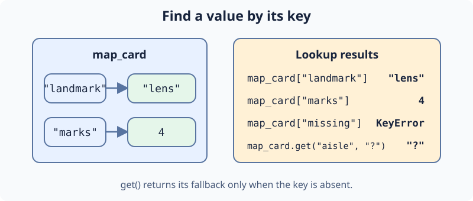

In the Map Archive, a dictionary gives each field a name. You can look up a landmark without remembering which position holds it.

`map_card["landmark"]` reads a value by its key. An assignment to `map_card["marks"]` updates that field. If a key is missing, bracket lookup raises `KeyError`; `map_card.get("route", "unknown")` returns the fallback instead.

Edit `main.py` so the first line reads the landmark. Run should print `lens` instead of `4`; the supplied later lines still show `Marks: 9` and `Route: unknown`. Then Submit.

## Your Task

1. Read `map_card["landmark"]` into `landmark`.
